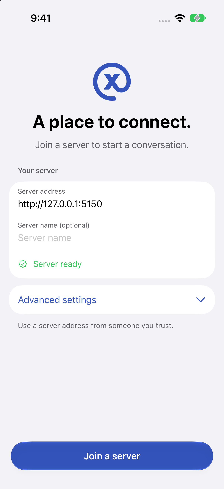
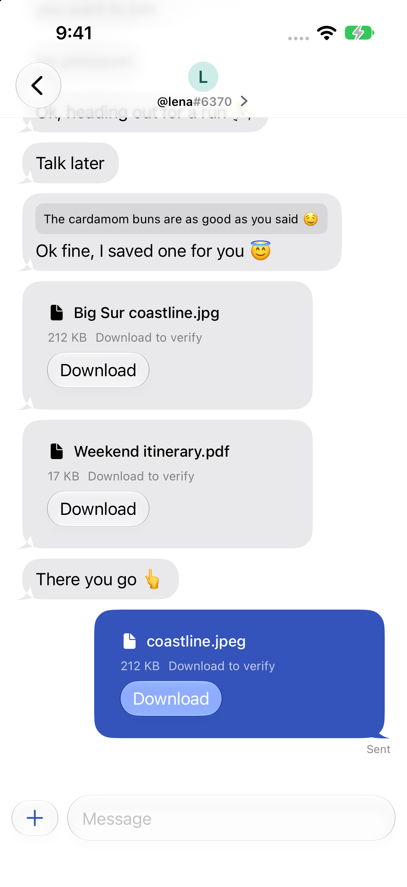
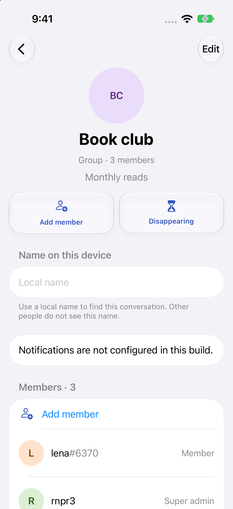
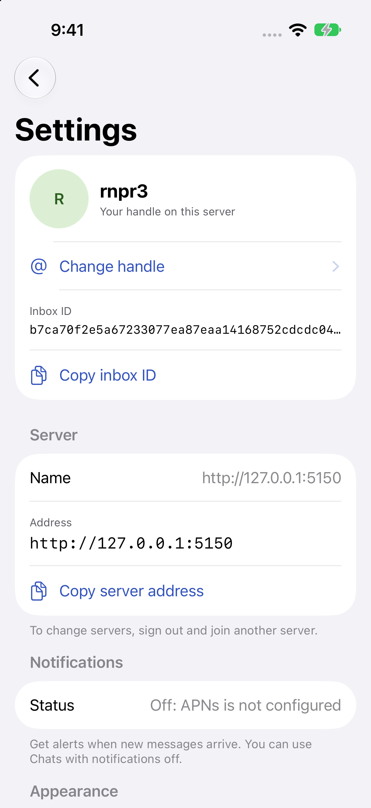

# XMTP Messenger for React Native

A React Native example for iOS 26 and later and Android, built with Expo
(bare workflow) against the React Native SDK package. On iOS it follows the
SwiftUI example in [`apps/example-ios`](../example-ios) screen by screen:
the same layout, copy, behavior and accessibility identifiers. Android runs
the same JavaScript with plain React Native versions of the iOS-only
controls. The supported development targets are the iOS simulator and the
Android emulator.

## Screenshots

Captured from the iOS simulator with local test accounts.

| Join a server                                                                 | Direct messaging                                                                    | Group details                                                                               | Settings                                                                    |
| ----------------------------------------------------------------------------- | ----------------------------------------------------------------------------------- | ------------------------------------------------------------------------------------------- | --------------------------------------------------------------------------- |
|  |  |  |  |

## Code structure

- `app/` holds the expo-router routes. Each route reads its parameters and renders a feature screen.
- `src/core/` holds values, policies and stores in pure TypeScript, ported from the iOS `ExampleCore` stores and tested with `node --test` against in-memory fakes. It has no React, Expo or SDK runtime imports.
- `src/session/` runs the SDK client, the profile index, the reset journal and the stream readers. Stores drop results from an ended session.
- `src/platform/` wraps Expo modules and the local module in `modules/messenger-platform` (launch environment, file protection, backup exclusion, navigation subtitle, row context menus).
- `src/ui/` is the design system. Native iOS leaves are SwiftUI through `@expo/ui` in `*.ios.tsx` files; the `*.tsx` files beside them are the Android versions.
- `src/features/<feature>/` holds each screen with its store wiring and its copy: `connect`, `handles`, `chats`, `requests`, `settings`, `new-conversation`, `chat`, `reactions`, `emoji`, `details`, `member`, `permissions`, `disappearing`, `metadata` and `attachments`.
- `ios/` and `android/` are committed native projects from the Expo bare template, edited by hand.

`AGENTS.md` describes the recipes, the design system rules and the session API in more detail.

## Connect

Server checks stay quiet until you press Join. The Access token field
appears only when the current server requires authentication, and it accepts
a raw token or a complete `Bearer <token>` value. Remote servers require
HTTPS; HTTP is allowed only for loopback.

Joining the same normalized URL reuses the profile and inbox. Sign out ends
the session and removes its access token and exported files; identity keys
and messages remain. Delete local data removes this server's local profile
and files and can resume after an interruption.

Choose a handle after joining, or skip and choose one in Settings. New
message and Add member accept handles with or without `@`, Ethereum
addresses and inbox IDs, and resolve them before any SDK write.

## Run locally

Run from the repository root. Start the backend, link the SDK package, then
start Metro and the app in separate terminals:

```sh
dev/nix-shell 'just backend up'
dev/nix-shell 'just example-react-native sdk'
dev/nix-shell 'just example-react-native install'
dev/nix-shell 'just example-react-native metro'
dev/nix-shell 'just example-react-native start-ios'
```

`start-ios` builds, installs and launches on the first available iPhone
simulator; set `XMTP_RN_SIMULATOR` to a name or UDID, and append
`--headless` to keep Simulator.app closed. The app uses this worktree's
backend; set `XMTP_BACKEND_URL` to use another server.
`CONFIGURATION=Release` builds an app with an embedded bundle that needs no
Metro. For Android, run `dev/nix-shell 'just example-react-native
start-android'` while Metro runs; it starts a scoped API 34 emulator.

Check the JavaScript before a change:

```sh
dev/nix-shell 'just example-react-native check'
```

Private and loopback attachment destinations are blocked by default. For a
trusted local backend only, launch with `XMTP_ALLOW_PRIVATE_ATTACHMENTS=1`
(exactly `1`); it allows **all** private and loopback attachment
destinations, as in the iOS example.

## What differs from the iOS app

Deliberate differences:

- No push notifications or Mute. Settings shows "Off: APNs is not
  configured", as the default iOS build does (Android: "Off: Firebase is not
  configured").
- No iPad split view; iPad uses the iPhone stack.
- New message opens as a standard sheet, without the zoom transition from
  the compose button.
- Preferences are plain JSON inside the protected, backup-excluded profile
  directory; iOS encrypts them with AES-GCM.
- Dates are formatted for en-US only, without the 24-hour setting.
- A chat stays mounted behind sheets and pushed screens; iOS tears it down
  and shows a spinner.
- Opening Add member starts with an empty field; iOS keeps the last lookup.
- The copy of a file opened in Quick Look stays in the profile's protected
  storage until the next Open or Save, or until the chat closes; iOS removes
  it when Quick Look closes. Expo's preview reports no dismissal.
- Toolbar buttons carry the iOS accessibility labels but not the iOS
  identifiers (`member.close`, `newConversation.next` and others), because
  React Native toolbar items take no test ID.
- Android uses the iOS layout with plain React Native controls and system
  alerts. It builds and runs, but is not styled for Android.

Visible differences that remain on iOS:

- Text at Dynamic Type sizes other than the default is up to about 10
  percent smaller than SwiftUI's at AX5, and avatars about 20 percent
  larger, so rows wrap differently.
- A short chat shows a hairline under the navigation bar at rest, and after
  "Jump to latest" the last row sits 16 pt higher than native.
- The Reactions, emoji and Add member sheets sit about 3 to 4 pt higher than
  SwiftUI's medium detent.
- In Media and files, a two-column byline wraps the date onto a second line
  where native fits it by under 1 pt.
- Toolbar icons dim while a popover confirmation is open; SwiftUI keeps them
  tinted.
- The pinned Message requests header is opaque; iOS blurs the content under
  it. The connection banner scrolls with the list; iOS pins it.

## Manual checks

The checks from the iOS README, adapted. Results are from the iOS 27.0
simulator (iPhone 17 Pro, Xcode 27.0) and an API 34 Android emulator,
against the local backend with seeded peers, on 2026-10-18. Debug-only
probes (`app/dev/*`) forced states that the backend cannot produce on
demand. A check without a device run is marked not run.

| Check                                                             | Expected result                                                                            | Result                                                                                                                                                                                            |
| ----------------------------------------------------------------- | ------------------------------------------------------------------------------------------ | ------------------------------------------------------------------------------------------------------------------------------------------------------------------------------------------------- |
| Every route and state in light and dark                           | Matches the native app's screenshots on the same simulator.                                | Run: about 60 states compared with native captures; the differences above remain.                                                                                                                 |
| Join, New message, send, react, attach, accept                    | Same path and sequence as native.                                                          | Run on iOS and Android. New message has no zoom transition.                                                                                                                                       |
| Reduce Motion                                                     | Cross-fades replace the transitions.                                                       | Run: New message cross-fades. Only the sent bubble fades in (native fades every new row).                                                                                                         |
| VoiceOver, AX5, Bold Text, Increase Contrast, Reduce Transparency | No clipped primary actions; labels work.                                                   | AX5 run on Chats, Settings, Details and the staged file. Labels checked in the accessibility hierarchy, not with VoiceOver running. Bold Text, Increase Contrast and Reduce Transparency not run. |
| iPad portrait and landscape                                       | Sidebar with selection.                                                                    | Not supported (single stack).                                                                                                                                                                     |
| Token-required server                                             | Field follows the server; Join waits for input.                                            | Not run: no local backend requires a token. Unit tests cover the model.                                                                                                                           |
| Failed restore                                                    | "Cannot restore this account. Try again." with Retry.                                      | Run on iOS and Android with the database removed.                                                                                                                                                 |
| Interrupted reset after database removal                          | Only "Continue local data removal"; finishing removes the profile and secrets.             | Partly run on Android: a reset that failed on a read-only folder was confirmed again and finished. The interrupted state after a relaunch not run.                                                |
| Change handle and switch back                                     | Each claim confirms.                                                                       | Partly run: the confirmation appears, then the server's seven-day rule refuses the change.                                                                                                        |
| Settings and appearance                                           | Eight sections in order; appearance survives relaunch.                                     | Run: sections in order, including Send needs review and Developer tools; Dark survives a relaunch.                                                                                                |
| More than 120 messages; delete saved anchor                       | No duplicate rows; "Position changed".                                                     | Run in a 135-message chat: older pages without duplicates, saved position restored, "Position changed" after the anchor was deleted.                                                              |
| Read position                                                     | Background, an older page and a noncurrent chat do not advance markers.                    | Unit tests only.                                                                                                                                                                                  |
| Stop and restart backend                                          | "Reconnecting" appears, then disappears.                                                   | Run against a backend behind a fault-injecting proxy.                                                                                                                                             |
| Force quit during send                                            | Unknown outcome locks the composer; listed in Send needs review; clearing does not resend. | Run with a Debug probe that fails a send after it may have queued, for a text and for a file. Force quit itself not run.                                                                          |
| Swipe reply; failed-message Retry and Edit                        | Haptic at 48 pt; Retry reuses the ID; Edit copies text.                                    | Swipe reply run. Retry of a held (unpublished) message run with a Debug probe. Edit and the "Not sent" state are unit-tested only.                                                                |
| Photo and Files pickers; oversized file                           | Both stage and send; limit enforced while copying.                                         | Run: a photo and a PDF staged and sent (peer read the same SHA-256); a Debug upload limit rejected a 17 KB file.                                                                                  |
| Server without attachments                                        | Controls hidden.                                                                           | Not run: needs the unsupported-backend fixture.                                                                                                                                                   |
| Interrupted upload                                                | Recovery offers review, assignment and discard.                                            | Run: app killed mid-upload (draft back as Waiting), an SDK-only upload assigned to a chat and sent, and an unknown outcome reviewed and discarded.                                                |
| Verified media                                                    | Download, verify, open, save; sign out removes exports.                                    | Run: download, Verified, Quick Look, Save to Files, and sign out removed the export copies.                                                                                                       |
| Metadata fixture with two members                                 | Set fields; the second member reads them.                                                  | Not run: the local backend registers no group fields. My fields Set empty, Save and Clear run.                                                                                                    |
| Disappearing and leave                                            | 1 hour, Custom 0, reject 9223372037 s without a write; pending leave.                      | Run: 1 hour, Custom 0 and 7200, the overflow rejected with no write, and Leave group shows "Membership change pending".                                                                           |
| Push builds                                                       | APNs alert and privacy checks.                                                             | Out of scope.                                                                                                                                                                                     |
| Launchers                                                         | Correct worktree URL; visible and headless launch.                                         | `start-ios --headless` and `start-android` run with this worktree's backend; visible `start-ios` not run.                                                                                         |
