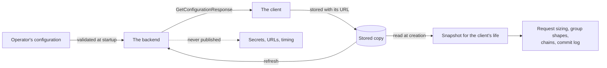

# Backend configuration

An operator configures one deployment. The backend publishes part of that configuration to every client and keeps the rest private. This spec owns that boundary, the public configuration wire format, and how a client fetches, stores, binds to, and applies it. A client sizes its requests to the published values, not to compiled constants, and a client database is bound to exactly one deployment by the identifier the operator chooses.



## Scope

In scope: the backend's configuration file, which is a contract with operators: the sources the backend reads it from, every key with its type, presence, default, and checks, environment references, which values are secret, and what a later release must still accept; the configuration checks the backend makes before it serves; the boundary between what is published and what stays private; the public configuration wire format; how a client fetches, validates, stores, and binds to it; what a refresh may change; the conditions under which a client stops; what a client sizes or rejects using it; and what an SDK exposes to an app.

Out of scope: what a key does once it is applied, and the checks and defaults that another spec states for a key, which the configuration field table cites by identifier. These include credentials and authorization ([AUTH](AUTH-backend-auth.md)), the backend API's enforcement of limits and its errors ([API section 7](API-backend-api.md#7-bounds-errors-and-transport)), per-caller rate limits and their defaults ([RATE](RATE-backend-rate-limits.md)), operations such as retention, readiness, and telemetry ([OPS](OPS-backend-operations.md)), push delivery ([PUSH](PUSH-push-subscriptions.md)), and attachment storage ([ATCH](ATCH-remote-attachments.md)). The platform a deployment runs on is also out of scope.

| Related | Relation |
| --- | --- |
| [AUTH](AUTH-backend-auth.md#6-client-credentials) | Owns what a credential is, when a client attaches one, which failures are terminal, and the checks of an enabled `[auth]` table that its rows state (AUTH-017, AUTH-029, AUTH-030, AUTH-032, AUTH-034). This spec owns what is published about auth, and the types, presence, and standard checks of the `[auth]` keys. |
| [API section 7](API-backend-api.md#7-bounds-errors-and-transport) | Owns what the backend does when a request exceeds a limit, and the fixed transport ceiling. This spec owns the published values and what a client does before it sends. |
| [OPS](OPS-backend-operations.md) | Owns retention enforcement, health, the identifier's use in telemetry, and the startup checks OPS-020, OPS-021, and OPS-022, which the configuration field table cites. |
| [PUSH](PUSH-push-subscriptions.md) | Owns push channels, delivery, and recipient expiry, with the defaults that PUSH-217 and PUSH-226 state. This spec owns the `[push]` keys and their checks, including CONF-091 and CONF-092. |
| [ATCH section 1](ATCH-remote-attachments.md#1-what-the-backend-publishes) | Owns the checks of the `[attachments]` keys that its rows state, the upload ceiling default of ATCH-003, and what is published about storage. This spec owns the layout and presence of that table and its other defaults. |
| [RATE](RATE-backend-rate-limits.md) | Owns what the `rate_limits` keys mean and the default limits. This spec owns their types, presence, and checks, including CONF-094. |
| [IDENT](IDENT-identity-updates.md) | Owns handles: the grammar and the rules for a claim in an identity log. This spec owns only the published minimum name length. |
| `EVENT` | EVENT-016 keeps local event subscriptions open after a server rejection. EVENT-001 owns the `client.rejected_by_server` event. |

## Terms

| Term | Meaning |
| --- | --- |
| Deployment | One backend an operator runs, with one configuration and one identifier. |
| Deployment identifier | The value of `GetConfigurationResponse.identifier`: the name an operator gives a deployment. A client database is bound to exactly one. |
| Backend URL | The address a client is configured to reach a deployment at. |
| Stored copy | The `GetConfigurationResponse` a client keeps in its database, with the backend URL it was fetched from and any conflicting identifier recorded under CONF-030. |
| Snapshot | The configuration a client resolves when it is created and reads for its life. |
| Compiled default | The value in the defaults table of section 3 that a client uses for a field its snapshot does not carry. |
| Advisory value | A published value the backend does not enforce, because only a client holds the state it is about. |
| Blocked connection | A condition that, once observed, fails later network work for the life of the client. |
| Refresh | A fetch of `GetConfiguration` by a client that already holds a snapshot, on its own schedule or when the app asks. |
| Credential source | The callback or key an app gives a client so that it can obtain credentials. [AUTH section 6](AUTH-backend-auth.md#6-client-credentials) defines the credential. |
| Configuration file | The TOML document an operator gives the backend at startup, inline or as a file (CONF-082). |
| Environment reference | A string value of the form `env:NAME` in the configuration file (CONF-084). |
| Secret value | The value of a key whose Type in the configuration field table is `secret string`. |
| Configuration field table | The table of section 1.2 with one row for every key of the configuration file. |
| Standard check | A check that the standard checks table of section 1.2 defines. |

## 1. What an operator configures

The backend validates its configuration before it serves. The rows below are the checks with a reason of their own that a client or an operator relies on: a published value a client would reject, or one the transport cannot honour. Section 1.1 states how the backend reads the configuration file. Section 1.2 lists every key with its type, presence, default, and checks. Section 1.3 is an example file.

| ID | Title | Requirement | Why |
| --- | --- | --- | --- |
| CONF-002 | Identifier is required | When the configured deployment identifier is absent, empty, longer than 256 bytes, or contains a whitespace or control character, the backend MUST refuse to start. | |
| CONF-003 | Stable identifier | An operator SHOULD NOT change a deployment identifier once a client has connected. | Every client database that reached this deployment is bound to the old value, and CONF-030 stops each of them permanently. |
| CONF-067 | Minimum version is a semantic version | When the configured minimum client version is set and is not a version under [Semantic Versioning 2.0.0 §2](https://semver.org/spec/v2.0.0.html#spec-item-2), the backend MUST refuse to start. | A client rejects an answer whose minimum does not parse (CONF-071), so a deployment that starts with one is unusable by every client. |
| CONF-005 | Explicit credential intent | When the configuration contains an `[auth]` table without an `enabled` key, the backend MUST refuse to start. | A configuration that gained the table before the key existed would otherwise serve without credentials, on the strength of an omission. |
| CONF-066 | Disabled auth values are unchecked | While the `[auth]` table has `enabled` set to `false`, the backend MUST NOT refuse to start because another key of that table fails a standard check, and MUST NOT fetch a key set. | |
| CONF-008 | Request budgets fit the transport | When the configured `max_request_bytes` or `max_response_bytes` is greater than the transport ceiling API-282 states, the backend MUST refuse to start. | A larger budget publishes a request size the transport refuses to carry, so a client sized to it fails every large request. |
| CONF-009 | Public configuration stays small | When the encoded `GetConfigurationResponse` the backend would publish is longer than 65536 bytes (64 KiB), the backend MUST refuse to start. | The message is served without a credential, so an unbounded one is an amplification source. Bounding the whole message bounds every list in it without a limit per list. |
| CONF-078 | Valid application catalogue | When an operator configures an application component, the backend MUST refuse to start unless its `component_id` is in `0xC000`–`0xFEFF`, its `name` contains 1 to 100 UTF-8 bytes, its `component_type` is one of the seven types in META section 2, all three member policies are present, and at least one of `in_groups` and `in_dms` is true; it MUST refuse duplicate IDs or names and a name equal to a well-known component name in META section 2. | An unusable or ambiguous definition would be published to every client, and a duplicate name makes name lookup ambiguous. |
| CONF-080 | Handle name minimum in range | When the configured `handles.min_name_length` is less than 1 or greater than 27, the backend MUST refuse to start. | A client reads a published 0 as not provided (CONF-025), so an app would check names against the compiled default instead. Above 27, every claim fails, because no name part is longer than 27 characters. |
| CONF-065 | Refusal names the key | When the backend refuses to start because a key or its value fails a rule in this section, it MUST report that key, and when it refuses under CONF-009, it MUST report that the public configuration is too large. | |

Application component definitions are a sending catalogue: a client copies them into the registry of a conversation it creates or refreshes, and the committed group registry, not the catalogue, governs every received change. CONF-009 applies to the response including the catalogue. Operator documentation states that a published definition's ID, name, type, policies, and conversation selection should stay stable, because a change reaches only conversations that register the ID later; no receive-side rule depends on that advice.

API-282 states the transport ceiling and the failure rule for a message above the ceiling or byte budget. API-281 owns the status codes.

A handle is a public name, such as `nick` or `nick#2341`, that an inbox claims in its identity log. `handles.min_name_length` is the shortest name part the backend admits in a claim. IDENT-078 states the handle grammar, whose name part is 1 to 27 characters, and IDENT-084 forbids a validator to check a claim's name part against this setting when it validates an identity log. API-297 makes the backend fail a publish with `REASON_HANDLE_NOT_ALLOWED` when a claim in it has a name part shorter than this setting. A change of the setting applies only to later claims. A handle claimed before the change stays valid.

### 1.1 The configuration file

An operator gives the backend one TOML document at startup, inline or as a file, and the backend reads it once (CONF-082). The file is a contract with the operator that outlives a release. A file that one release accepts, every later release also accepts, and reads each value in the same unit (CONF-086).

The key set is closed. A key that the configuration field table does not list is refused (CONF-083), because an ignored key would leave its default in force while the operator believes the setting changed. A key the operator chooses, such as a chain id or an API key name, fills a position that the field table shows in angle brackets.

A string value of the form `env:NAME` is an environment reference. The backend replaces it with the value of the environment variable `NAME` before any other check (CONF-084). Every check therefore sees the resolved value, and a reference inside a disabled `[auth]` table must still resolve. Only a string value can be a reference: a table key, an integer, a float, and a boolean cannot come from the environment.

The field table gives the type `secret string` to credentials, and to the URLs of the store, the chain RPC services, the OTLP collector, and the storage endpoint, which can carry credentials. API key values and the JWKS URL have the type `string`, because AUTH-027 governs them. An environment reference keeps a secret value out of the file. CONF-011 and ATCH-006 keep secret values out of the published configuration, and CONF-085 keeps them out of the backend's output.

| ID | Title | Requirement | Why |
| --- | --- | --- | --- |
| CONF-082 | One configuration source | The backend MUST read its configuration as one [TOML v1.1.0](https://toml.io/en/v1.1.0) document from the file `--config-file` names, or else from `--config`, or else from the `XMTP_CONFIG` environment variable. When `--config-file` is given together with `--config` or `XMTP_CONFIG`, when none of the three is given, when the named file cannot be read, or when the document is not valid TOML v1.1.0, the backend MUST refuse to start. | An instance given two sources would run on a source its operator did not choose. |
| CONF-083 | Unknown keys are refused | When the configuration holds a key that the configuration field table does not list, or lists only for a credential `kind` other than the one its table sets, the backend MUST refuse to start. A key the operator chooses, in a position the table shows in angle brackets, is listed. | A misspelled key would be ignored and its default applied, so the deployment would run on a value its operator believes they changed. |
| CONF-084 | Environment references resolve once | When a string value anywhere in the configuration begins with `env:`, the backend MUST replace it, after it parses the document and before any other check of this section, with the value of the environment variable that the rest of the string names, and MUST NOT read the replacement as a reference. When that name is empty, or the variable is not set or does not hold valid Unicode, the backend MUST refuse to start, and in the second case MUST name the variable. | A reference read as written would run the deployment on the text `env:NAME` as a URL, key, or audience. A value read a second time would let the content of one secret select another variable. |
| CONF-085 | Secret values stay out of output | The backend MUST NOT write a secret value, or any part of one other than the host of a URL, to a log entry, a span field, a metric label, its help output, or a refusal message other than one under OPS-022, whether the file holds the value or an environment reference supplies it. | Logs, spans, metrics, help output, and refusals reach terminals, collectors, and people who never hold the secret. A database URL or a provider key in them is a credential leak. |
| CONF-086 | Files stay valid across releases | When a configuration file passes every check that section 1 states or cites under one release of the backend, every later release given the same host, environment variables, store, and JWKS document MUST NOT refuse that file under a check that its own section 1 states or cites, and MUST NOT read a value in it in a unit other than the one the earlier release used. | An operator upgrades by replacing the binary. A release that refuses a working file takes the deployment down, and one that reads a value in another unit changes the deployment without an edit by the operator. |

### 1.2 Keys and checks

The configuration field table lists every key of the configuration file. Its columns mean:

- Key: the dotted path. `a.b` is key `b` of table `a`, a word in angle brackets such as `<name>` is a key the operator chooses, and `[]` is one entry of an array of tables. Every table on a listed path has a row of its own.
- Type: the TOML type ([TOML v1.1.0](https://toml.io/en/v1.1.0)). `table` includes an inline table, and `array of tables` includes an array of inline tables. `non-negative integer` is an integer not less than 0, and `number` is a float or an integer. `secret string` is a string that holds a secret value.
- Presence: `required` or `optional`, sometimes under a condition, such as the presence of the enclosing table or the credential `kind`. An identifier after a semicolon names the requirement that governs the key's presence in place of CONF-087. An optional table may be omitted, and each of its keys is then absent.
- Default: what applies when the key is absent. A value, or `section 3`, is what the backend applies under CONF-088. `section 3` is the compiled default that the defaults table of section 3 gives for the field the key is published as. An identifier, or a section or term of another spec, points at the requirement that states the default, and that requirement governs it. `absent` means the key stays unset, and the requirement that reads the key gives the effect. `none` marks a key whose absence is refused.
- Checks: standard checks with their parameters, separated by commas. Every one of them must pass. After a semicolon come the identifiers of rules, in this spec or another, that also bind the key. A cell with only identifiers begins with the semicolon. `key` before a check or an identifier applies it to the key in angle brackets instead of to its value. On an array, `non-empty` applies to the array, and every other standard check applies to each element.
- Notes: informative.

The standard checks table defines each standard check. A rule that relates keys, needs a fact the backend learns at startup, or loads credential material has a row of its own after the tables. The backend applies the checks before it serves (OPS-005). CONF-065 says what a refusal names. When more than one check fails, which failure the refusal reports is not specified. Inside an `[auth]` table whose `enabled` is `false`, the standard checks do not apply (CONF-066), but CONF-083, CONF-084, and the Type and Presence columns do.

| Check | Meaning |
| --- | --- |
| `range A..B` | The value is not less than A, not greater than B, and not NaN. On a `number` key, A, B, and the value may be floats. When B is omitted, the only upper bound is the largest TOML integer. |
| `bytes A..B` | The UTF-8 encoding of the string is A to B bytes long. |
| `non-empty` | The string is at least one byte long, or the array holds at least one element. |
| `non-blank` | The string holds at least one character that is not Unicode `White_Space`. |
| `entries ..B` | The table holds at most B keys. |
| `one of: V, ...` | The string equals one of the listed values, byte for byte. When `one of` is followed by an identifier, the listed values are those that requirement accepts. |
| `not: V, ...` | The string equals none of the listed values, byte for byte. |
| `pattern R` | The whole string matches the regular expression R, read under [ECMA-262 §22.2](https://tc39.es/ecma262/#sec-regexp-regular-expression-objects) with no flags. |
| `socket address` | The string is an IPv4 address, or an IPv6 address in square brackets. An IPv4 address is four decimal numbers from 0 to 255, each without a leading zero, joined by `.`. An IPv6 address follows [RFC 4291 §2.2](https://www.rfc-editor.org/rfc/rfc4291#section-2.2), and inside the brackets `%` and a decimal zone index may follow it. After the address come `:` and a decimal port from 0 to 65535. A host name does not pass. |
| `socket address or empty` | The string is empty, or passes `socket address`. |
| `ip address` | The string is an IPv4 address, written as in `socket address`, or an IPv6 address following [RFC 4291 §2.2](https://www.rfc-editor.org/rfc/rfc4291#section-2.2) without brackets or a zone index. |
| `ip network` | The string passes `ip address`, followed by `/` and a decimal prefix length from 0 to 32 for IPv4 or 0 to 128 for IPv6, with every bit after the prefix 0. |
| `url S` | The string begins with `S://` for one of the listed schemes S. The [WHATWG URL Standard basic URL parser](https://url.spec.whatwg.org/#concept-basic-url-parser), given no base URL, returns a URL for it. |
| `secure url` | The basic URL parser, given no base URL, returns a URL for the string that has a host. Its scheme is `https`, or `http` when the host is `localhost`, an IPv4 address in `127.0.0.0/8`, or `::1`. |
| `plain url` | The string is ASCII with no control character, no white space, and no `\`, and has no `%` between `://` and the next `/`. The basic URL parser, given no base URL, returns a URL for it that has a host and no username, password, query, or fragment. An IPv4 host is written in the dotted-decimal form that the parser serializes. |
| `host name` | The string is an optional `*.` followed by a host of 1 to 253 bytes. The host is labels joined by `.`. Each label is 1 to 63 ASCII letters, digits, or `-`, and no label begins or ends with `-`. |

| Key | Type | Presence | Default | Checks | Notes |
| --- | --- | --- | --- | --- | --- |
| `server` | table | required; CONF-002 | none | | CONF-002 requires `server.identifier`. |
| `server.identifier` | string | required; CONF-002 | none | ; CONF-002 | The deployment identifier, published as `identifier`. CONF-003 asks the operator to keep it stable. |
| `server.min_libxmtp_version` | string | optional | absent | ; CONF-067 | Published as `min_libxmtp_version`, which CONF-069 leaves empty when the key is absent. Clients apply it (CONF-049, CONF-036). |
| `server.listen` | string | optional | `"0.0.0.0:5050"` | `socket address` | The listener of OPS-004 and API-285. |
| `server.log_level` | string | optional | `"info"` | `one of: off, error, warn, info, debug, trace` | The `--log-level` option replaces it. The OPS-018 log needs a level that admits `info`. |
| `server.log_format` | string | optional | `"text"` | `one of: text, json` | `json` writes one JSON event per line. |
| `server.request_logger` | boolean | optional | OPS-018 | | Turns the completion log of OPS-018 on or off. |
| `server.max_drain_duration_ms` | integer | optional | OPS Terms (Drain deadline) | `range 1..4294967295` | The drain deadline of OPS-008. |
| `telemetry` | table | optional | `{}` | | |
| `telemetry.metrics_listen` | string | optional | `"0.0.0.0:9464"` | `socket address or empty`; OPS-022 | The metrics listener of OPS-016. |
| `telemetry.otlp_endpoint` | secret string | optional | absent | ; OPS-022 | When absent, OPS-022 reads `OTEL_EXPORTER_OTLP_ENDPOINT`. |
| `telemetry.otlp_logs` | boolean | optional | `false` | | Also exports logs to the OTLP endpoint. |
| `telemetry.service_name` | string | optional | OPS-013 | `non-blank` | The `service.name` of OPS-013. |
| `telemetry.sample_ratio` | number | optional | `1.0` | `range 0.0..1.0` | Share of root traces recorded. |
| `telemetry.resource_attributes` | table | optional | `{}` | | Extra OpenTelemetry resource attributes, exported as written. |
| `telemetry.resource_attributes.<name>` | string | optional | absent | key `not: service.name, service.version, xmtp.backend.identifier` | OPS-013 sets the three reserved names. |
| `database` | table | required | none | | |
| `database.url` | secret string | required | none | `url postgres, postgresql` | The primary store. |
| `database.replica_url` | secret string | optional | absent | `url postgres, postgresql` | One streaming read replica. OPS section 4 says which reads may answer from a lagged copy. |
| `database.max_connections` | integer | optional | `20` | `range 1..4294967295` | Connections in each request pool, with one pool for each database URL. |
| `database.max_statement_timeout_ms` | integer | optional | `5000` | `range 1..2147483647`; CONF-089 | Statement timeout on every pooled connection. |
| `publishing` | table | optional | `{}` | | |
| `publishing.max_publish_duration_ms` | integer | optional | `10000` | `range 1..2147483647`; CONF-089 | Bound on one publish, from its first lock to its commit. |
| `publishing.max_barrier_wait_ms` | integer | optional | `1000` | `range 1..2147483647` | Wait for the allocation barrier of API-203 before a retry. |
| `streams` | table | optional | `{}` | | |
| `streams.poll_interval_ms` | integer | optional | `100` | `range 1..4294967295` | Interval between polls of the read database by the stream tailer and the push dispatcher. |
| `streams.max_gap_ranges` | integer | optional | `10000` | `range 1..` | The gap-range bound of OPS-006. |
| `streams.keepalive_interval_ms` | integer | optional | `30000` | `range 1..4294967295` | The interval of API-250 and API-255. |
| `streams.max_pong_wait_ms` | integer | optional | API-257 | `range 1..4294967295` | The Pong wait of API-257. |
| `retention` | table | optional | `{}` | | |
| `retention.group_message_seconds` | integer | optional | section 3 | `range 1..`; OPS-020 | A retention period of OPS section 1. |
| `retention.welcome_seconds` | integer | optional | section 3 | `range 1..`; OPS-020 | A retention period of OPS section 1. |
| `retention.key_package_seconds` | integer | optional | section 3 | `range 1..`; OPS-020 | A retention period of OPS section 1. |
| `validation` | table | optional | `{}` | | |
| `validation.max_scw_cache_entries` | integer | optional | `10000` | `range 1..` | Entries in the instance's cache of smart contract wallet verdicts. |
| `limits` | table | optional | `{}` | | |
| `limits.max_push_topics` | integer | optional | PUSH-217 | `range 1..2147483647` | The `max_push_topics` of PUSH-217. Not published. |
| `limits.max_query_topics` | integer | optional | section 3 | `range 1..4294967295` | |
| `limits.default_query_limit` | integer | optional | section 3 | `range 1..4294967295`; CONF-089 | API-241. |
| `limits.max_query_limit` | integer | optional | section 3 | `range 1..4294967295`; CONF-089 | API-241. |
| `limits.max_newest_metadata_topics` | integer | optional | section 3 | `range 1..4294967295` | |
| `limits.max_newest_full_topics` | integer | optional | section 3 | `range 1..4294967295` | |
| `limits.max_publish_topics` | integer | optional | section 3 | `range 1..4294967295` | |
| `limits.max_envelope_bytes` | integer | optional | section 3 | `range 1..`; OPS-021 | |
| `limits.max_request_bytes` | integer | optional | section 3 | `range 1..`; CONF-008, OPS-021 | Also bounds a Subscribe update frame (section 6). |
| `limits.max_response_bytes` | integer | optional | section 3 | `range 1..`; CONF-008, OPS-021 | |
| `limits.max_update_adds` | integer | optional | section 3 | `range 1..4294967295`; CONF-089 | |
| `limits.max_update_removes` | integer | optional | section 3 | `range 1..4294967295` | |
| `limits.max_stream_topics` | integer | optional | section 3 | `range 1..4294967295`; CONF-089 | |
| `limits.max_static_topics` | integer | optional | section 3 | `range 1..4294967295` | |
| `limits.max_lookup_identifiers` | integer | optional | section 3 | `range 1..4294967295` | |
| `limits.max_scw_signatures` | integer | optional | section 3 | `range 1..200` | Not above two for each action IDENT-094 allows, the most ERC-6492 signatures one identity update can carry. Clients size verify requests by it. |
| `limits.max_identity_entries` | integer | optional | section 3 | `range 1..4294967295` | API-234. |
| `limits.max_http2_streams` | integer | optional | `100` | `range 1..4294967295` | Concurrent HTTP/2 streams per connection. Open subscriptions count toward it. Not published. |
| `limits.max_update_frames_per_second` | integer | optional | section 3 | `range 1..4294967295` | API-258. |
| `limits.max_update_burst` | integer | optional | section 3 | `range 1..4294967295` | API-258. |
| `limits.max_ping_frames_per_second` | integer | optional | section 3 | `range 1..4294967295` | API-258. |
| `limits.max_ping_burst` | integer | optional | section 3 | `range 1..4294967295` | API-258. |
| `rate_limits` | table | optional | `{}` | | RATE. |
| `rate_limits.enabled` | boolean | optional | `true` | | When `false`: RATE-012. |
| `rate_limits.max_memory_mib` | integer | optional | `100` | `range 1..65536` | The bound of RATE-050. |
| `rate_limits.trusted_proxies` | array of strings | optional | `[]` | `ip network` | The trusted proxies of RATE-002. |
| `rate_limits.categories` | table | optional | `{}` | | |
| `rate_limits.categories.<category>` | table | optional | absent | key `one of: request, publish, identity_update, chain_verify, push, upload, stream_rent` | The categories of RATE section 2. |
| `rate_limits.categories.<category>.<tier>` | array of tables | optional | RATE-025 | key `one of: default, ip, jwt, api_key`; CONF-094 | The limits RATE-025 applies. `[]` admits every spend. |
| `rate_limits.categories.<category>.<tier>[].count` | integer | required | none | `range 1..4294967295`; CONF-094 | |
| `rate_limits.categories.<category>.<tier>[].window_seconds` | integer | required | none | `range 1..2592000` | |
| `rate_limits.overrides` | array of tables | optional | `[]` | ; CONF-094 | One caller each. |
| `rate_limits.overrides[].api_key` | string | optional; CONF-094 | absent | `pattern ^[A-Za-z0-9][A-Za-z0-9._-]{0,63}$` | An API key name (AUTH-028). |
| `rate_limits.overrides[].jwt_issuer` | string | optional; CONF-094 | absent | | The `iss` of RATE-001. When absent, the override names a token with no `iss`. |
| `rate_limits.overrides[].jwt_subject` | string | optional; CONF-094 | absent | `non-empty` | The `sub` of RATE-001. |
| `rate_limits.overrides[].ip` | string | optional; CONF-094 | absent | `ip address` | An IPv6 address names its /64 (RATE-003). |
| `rate_limits.overrides[].limits` | table | required in `rate_limits.overrides[]` | none | | |
| `rate_limits.overrides[].limits.<category>` | array of tables | optional | absent | key `one of: request, publish, identity_update, chain_verify, push, upload, stream_rent`; CONF-094 | `[]` admits every spend. |
| `rate_limits.overrides[].limits.<category>[].count` | integer | required | none | `range 1..4294967295`; CONF-094 | |
| `rate_limits.overrides[].limits.<category>[].window_seconds` | integer | required | none | `range 1..2592000` | |
| `mls` | table | optional | `{}` | | |
| `mls.max_group_members` | integer | optional | section 3 | `range 1..65535` | Advisory. Clients apply it (CONF-043). |
| `mls.max_installations_per_inbox` | integer | optional | section 3 | `range 1..100` | Advisory. Clients apply it (CONF-044). Not above the action limit of IDENT-094, so one update can revoke every installation within the ceiling. |
| `mls.commit_log_enabled` | boolean | optional | section 3 | | CONF-045. |
| `handles` | table | optional | `{}` | | |
| `handles.min_name_length` | integer | optional | section 3 | ; CONF-080 | API-297 applies it to claims. |
| `chains` | table | optional | `{}` | | Section 3 gives a client's reading of an empty table. |
| `chains.<chain id>` | secret string | optional | absent | `url http, https`; key CONF-090 | The chain's JSON-RPC URL. The key is published (CONF-070); the URL is not (CONF-011). |
| `auth` | table | optional | absent | | When absent: AUTH-003. |
| `auth.enabled` | boolean | required in `[auth]`; CONF-005 | none | | When `false`: CONF-066. |
| `auth.jwks_url` | string | optional | absent | `secure url`; AUTH-015, AUTH-017, AUTH-029 | AUTH-027 keeps the part after its host out of diagnostics. |
| `auth.keys` | array of tables | optional | absent | `non-empty`; AUTH-029 | Inline signing keys. |
| `auth.keys[].kid` | string | required while `auth.enabled` is `true` | absent | `bytes 1..256`; AUTH-017 | Published (CONF-068). |
| `auth.keys[].alg` | string | required | none | `one of` AUTH-008; AUTH-017 | Published (CONF-068). |
| `auth.keys[].public_key` | string | required | none | ; AUTH-017 | PEM text, not a path. Never published (CONF-011). |
| `auth.api_keys` | table | optional | `{}` | `entries ..256` | An empty table configures no API key under AUTH-029. |
| `auth.api_keys.<name>` | string | optional | absent | key `pattern ^[A-Za-z0-9][A-Za-z0-9._-]{0,63}$`; AUTH-030 | The name is the principal (AUTH-028). AUTH-027 keeps the value out of diagnostics. |
| `auth.audiences` | array of strings | optional | absent | `non-empty` | AUTH-012. |
| `auth.issuers` | array of strings | optional | absent | `non-empty` | AUTH-012. |
| `auth.required_scopes` | array of strings | optional | `[]` | | AUTH-013. Published (CONF-068). |
| `auth.leeway_seconds` | non-negative integer | optional | AUTH Terms (Leeway) | ; AUTH-032 | AUTH-011. |
| `auth.jwks_refresh_seconds` | non-negative integer | optional | AUTH-018 | ; AUTH-034 | |
| `auth.jwks_max_stale_seconds` | non-negative integer | optional | AUTH-019 | `range 0..4294967295`; AUTH-034 | |
| `push` | table | optional | `{}` | | |
| `push.recipient_ttl_seconds` | integer | optional | PUSH-226 | `range 86400..`; CONF-091 | |
| `push.max_attempts` | integer | optional | `3` | `range 1..10` | Provider attempts for each delivery (PUSH section 7). |
| `push.apns` | table | optional | absent | | When present, the APNs channel exists (PUSH-210). |
| `push.apns.key` | secret string | required in `[push.apns]` | none | `non-empty`; CONF-092 | PEM text, not a path. |
| `push.apns.key_id` | string | required in `[push.apns]` | none | `non-empty` | Apple's id of the signing key (PUSH-259). |
| `push.apns.team_id` | string | required in `[push.apns]` | none | `non-empty` | Issuer of the provider token (PUSH-259). |
| `push.apns.bundle_id` | string | required in `[push.apns]` | none | `non-empty` | The `apns-topic` of PUSH-259. |
| `push.apns.environment` | string | required in `[push.apns]` | none | `one of: production, sandbox` | Selects the host of PUSH-259. |
| `push.fcm` | table | optional | absent | | When present, the FCM channel exists (PUSH-210). |
| `push.fcm.service_account` | secret string | required in `[push.fcm]` | none | `non-empty`; CONF-092 | JSON text, not a path. |
| `push.http` | table | optional | absent | | When present, even if empty, the HTTPS channel exists (PUSH-210). |
| `push.http.allowed_domains` | array of strings | optional | absent | `host name` | PUSH-256 reads it. When it is absent or empty, every host passes the list. |
| `push.http.allow_private_addresses` | boolean | optional | `false` | | PUSH-256. |
| `attachments` | table | optional | absent | | ATCH-001. |
| `attachments.base_url` | string | required in `[attachments]` | none | ; ATCH-002 | Published. |
| `attachments.max_upload_bytes` | non-negative integer | optional | ATCH-003 | ; ATCH-003 | |
| `attachments.retention_seconds` | non-negative integer | optional | absent | ; ATCH-004 | ATCH-004 publishes 0 when it is absent. ATCH-005 asks the operator to match the target's expiry rule. |
| `attachments.target` | table | required in `[attachments]` | none | | Holds the one target table. |
| `attachments.target.S3` | table | required in `[attachments.target]` | none | | ATCH-007 says which targets fit. |
| `attachments.target.S3.endpoint` | secret string | required in `[attachments.target.S3]` | none | `plain url`; ATCH-071 | Never published (ATCH-006). |
| `attachments.target.S3.region` | string | required in `[attachments.target.S3]` | none | ; ATCH-081 | |
| `attachments.target.S3.bucket` | string | required in `[attachments.target.S3]` | none | ; ATCH-081 | Never published (ATCH-006). |
| `attachments.target.S3.key_prefix` | string | optional | `""` | ; ATCH-075 | Put before the object name with no separator added. |
| `attachments.target.S3.presign_ttl_seconds` | integer | optional | `900` | ; ATCH-083 | ATCH-028. |
| `attachments.target.S3.credentials` | table | required in `[attachments.target.S3]` | none | | |
| `attachments.target.S3.credentials.kind` | string | required in `[attachments.target.S3.credentials]`; ATCH-073 | none | ; ATCH-073 | |
| `attachments.target.S3.credentials.access_key_id` | secret string | required when `kind` is `static`; ATCH-073 | none | ; ATCH-073 | |
| `attachments.target.S3.credentials.secret_access_key` | secret string | required when `kind` is `static`; ATCH-073 | none | ; ATCH-073 | |
| `attachments.target.S3.credentials.session_token` | secret string | optional when `kind` is `static` | absent | | |
| `attachments.target.S3.credentials.name` | string | required when `kind` is `profile`; ATCH-073 | none | ; ATCH-073 | |
| `attachments.target.S3.credentials.account_id` | string | required when `kind` is `sso`; ATCH-073 | none | ; ATCH-073 | |
| `attachments.target.S3.credentials.region` | string | required when `kind` is `sso`; ATCH-073 | none | ; ATCH-073 | |
| `attachments.target.S3.credentials.role_name` | string | required when `kind` is `sso`; ATCH-073 | none | ; ATCH-073 | |
| `attachments.target.S3.credentials.start_url` | string | required when `kind` is `sso`; ATCH-073 | none | ; ATCH-073 | |
| `attachments.target.S3.credentials.session_name` | string | optional when `kind` is `sso` or `assume_role` | absent | | |
| `attachments.target.S3.credentials.command` | string | required when `kind` is `process`; ATCH-073 | none | ; ATCH-073 | |
| `attachments.target.S3.credentials.role_arn` | string | required when `kind` is `assume_role`; ATCH-073 | none | ; ATCH-073 | |
| `attachments.target.S3.credentials.external_id` | string | optional when `kind` is `assume_role` | absent | | |
| `application_components` | array of tables | optional | `[]` | | Published under CONF-079. Counts toward CONF-009. |
| `application_components[].component_id` | integer | required; CONF-078 | none | ; CONF-078 | META section 1 gives the write-once range. |
| `application_components[].name` | string | required; CONF-078 | none | ; CONF-078 | META section 2 gives the `USER_` prefix convention. |
| `application_components[].component_type` | string | required; CONF-078 | none | ; CONF-078 | A type of META section 2, written in lowercase without its prefix: `bytes`, `string`, `tls_map_bytes_bytes`, `tls_map_inbox_id_bytes`, `tls_set_bytes`, `tls_set_inbox_id`, or `tls_map_inbox_id_string`. |
| `application_components[].insert_policy` | string | required; CONF-078 | none | `one of: allow, deny, allow_if_admin, allow_if_super_admin, allow_if_self_or_non_member`; CONF-078 | Who may add a value. Each value is a `MetadataBasePolicy` name in lowercase. |
| `application_components[].update_policy` | string | required; CONF-078 | none | `one of: allow, deny, allow_if_admin, allow_if_super_admin, allow_if_self_or_non_member`; CONF-078 | Who may change a value. META-004 refuses a change to a write-once component. |
| `application_components[].delete_policy` | string | required; CONF-078 | none | `one of: allow, deny, allow_if_admin, allow_if_super_admin, allow_if_self_or_non_member`; CONF-078 | Who may remove a value. |
| `application_components[].in_groups` | boolean | required; CONF-078 | none | ; CONF-078 | Register the field in new groups. |
| `application_components[].in_dms` | boolean | required; CONF-078 | none | ; CONF-078 | Register the field in new DMs. |

| ID | Title | Requirement | Why |
| --- | --- | --- | --- |
| CONF-087 | Field table is enforced | When a key whose row in the configuration field table makes it required, and whose Presence cell names no requirement, is absent, when a value does not have the type its row's Type cell gives, or when, outside an `[auth]` table whose `enabled` is `false`, a value fails a check from the standard checks table that its row's Checks cell names, the backend MUST refuse to start. | A value outside its range reaches code that cannot honour it: a timeout the store refuses, a count published as a number other than the one enforced (CONF-069), or a zero that clients read as not provided (CONF-025). |
| CONF-088 | Absent keys take their default | When the configuration omits an optional key whose Default cell in the configuration field table holds a value or `section 3`, the backend MUST apply that value. For `section 3`, the value is the compiled default that section 3 gives for the field the key is published as. | An operator who omits a key relies on the value this table documents. Any other value changes a limit, a timeout, or a published field the operator never set. |
| CONF-089 | Related keys agree | When `publishing.max_publish_duration_ms` is not greater than `database.max_statement_timeout_ms`, `limits.max_query_limit` is less than `limits.default_query_limit`, or `limits.max_update_adds` is greater than `limits.max_stream_topics`, the backend MUST refuse to start. | Each pair nests one bound inside another. When a pair is inverted, a publish ends at its own deadline before its statement timeout can act, a page for `limit` 0 is larger than the published `max_query_limit`, and an update of `max_update_adds` topics is refused. |
| CONF-090 | Chain keys are EIP-155 ids | When a key of the `chains` table is not `eip155:` followed by a chain id in the decimal form IDENT-093 requires and not greater than 18446744073709551615, the backend MUST refuse to start. | A key in another form is published (CONF-070) but never equals the chain of a signature that IDENT-093 admits, so no signature on that chain is ever verified. |
| CONF-091 | Push expiry fits the clock | When `push.recipient_ttl_seconds`, converted to nanoseconds and added to the primary store's clock at startup, cannot be represented as a signed 64-bit nanosecond timestamp, the backend MUST refuse to start. | Otherwise every `Register` fails with `INTERNAL`, because the `expires_at_ns` that PUSH-255 returns cannot be computed, while the instance reports SERVING. |
| CONF-092 | Push credentials load at startup | When `[push.apns]` is present and its `key` is not a PEM-encoded private key ([RFC 7468 §10](https://www.rfc-editor.org/rfc/rfc7468#section-10)) in the form of [RFC 5958 §2](https://www.rfc-editor.org/rfc/rfc5958#section-2) on the curve `secp256r1` ([RFC 5480 §2.1.1.1](https://www.rfc-editor.org/rfc/rfc5480#section-2.1.1.1)), the backend MUST refuse to start. When `[push.fcm]` is present and its `service_account` is not a JSON object ([RFC 8259 §4](https://www.rfc-editor.org/rfc/rfc8259#section-4)) whose `project_id` is a string of one or more ASCII letters, digits, or `-`, whose `client_email` is a string that is not empty, whose `private_key` is a PEM-encoded RSA private key ([RFC 8017 §3.2](https://www.rfc-editor.org/rfc/rfc8017#section-3.2)) in the same form, and whose `token_uri` is `https://oauth2.googleapis.com/token`, the backend MUST refuse to start. | Otherwise the backend reports SERVING while every delivery on that channel fails. Any other `token_uri` would send the signed token request to a host the file names. |
| CONF-094 | Rate limit lists and overrides agree | When a list of limits under `rate_limits` holds more than 3 entries, two entries with equal `window_seconds`, or an entry whose `count` is greater than 1,000,000,000 × its `window_seconds`, when an entry of `rate_limits.overrides` sets none or more than one of `api_key`, `jwt_subject`, and `ip`, or sets `jwt_issuer` without `jwt_subject`, or when two entries name the same caller key under RATE-001 and RATE-003, the backend MUST refuse to start. | Two overrides for one caller make the applied limits depend on file order, a fourth limit has nowhere to be recorded, and a limit of more than one unit per nanosecond is earned back at once, so it admits every spend. |
| CONF-095 | Unsafe settings are reported | Before it serves, the backend MUST log, while the configured log level admits WARN, one entry at level WARN for each of these settings, and MUST NOT refuse to start because of any of them: auth disabled while `server.listen` is not a loopback address; a `database.url` or `database.replica_url` whose host is not a loopback address, `localhost`, or a Unix socket and whose TLS mode is not `verify-full`, where the TLS mode is the URL's `sslmode` parameter, or else the `PGSSLMODE` environment variable, or else `prefer`; and a `chains` URL whose scheme is `http` and whose host is not a loopback address or `localhost`. Each entry MUST name the key and, for a store URL, the TLS mode. | CONF-086 keeps these files valid, so a log entry is how an operator learns that any caller is admitted without a credential, or that a party on the network path can read and rewrite the store link or forge a chain's answers. |

### 1.3 Example configuration

The file below gives every key a value that passes the checks of section 1.2. Where keys exclude one another, the key is shown in a comment instead. A comment above each key says what it does. The file is informative. The commented choices are `[[auth.keys]]` in place of `auth.jwks_url`, and each storage credential `kind` other than `web_identity`, with the keys that kind takes. Secret values are environment references.

```toml
# Backend configuration with every key set. Secret values are environment
# references; set those variables in the backend's environment.

[server]
# Stable name of this deployment, in reverse DNS form. Every client database
# binds to it on first connect, so never change it after clients connect.
identifier = "org.example.xmtp"
# Oldest libxmtp version this deployment accepts. Clients compare major,
# minor, and patch, and refuse to run when they are older. Omit it to accept
# every version.
min_libxmtp_version = "1.10.0"
# Address and port of the listener that serves gRPC, gRPC-Web, and health.
listen = "0.0.0.0:5050"
# Log level: off, error, warn, info, debug, or trace. Request completion logs
# need info or a more detailed level. The --log-level option overrides it.
log_level = "info"
# Log encoding on standard output: text, or json for one JSON event per line.
log_format = "json"
# Write one completion log line for each gRPC request.
request_logger = true
# Milliseconds that shutdown gives running requests to finish. OPS-008 says
# when the process exits after that; keep that below your orchestrator's kill
# timeout.
max_drain_duration_ms = 10000

[telemetry]
# Prometheus listener. Keep it on a private network. An empty string turns
# the listener off; metrics are still recorded.
metrics_listen = "0.0.0.0:9464"
# OTLP gRPC collector for traces. Omit it to use OTEL_EXPORTER_OTLP_ENDPOINT;
# with neither, nothing is exported.
otlp_endpoint = "env:XMTP_OTLP_ENDPOINT"
# Also export logs to the OTLP collector.
otlp_logs = true
# service.name on every exported span. Give each backend its own name when
# several share one collector.
service_name = "xmtp-backend"
# Share of new traces to record, from 0.0 to 1.0. Metrics do not depend on it.
sample_ratio = 0.25

[telemetry.resource_attributes]
# Extra OpenTelemetry resource attributes, exported as written on every
# signal. service.name, service.version, and xmtp.backend.identifier are set by
# the backend and cannot be used. Never put a secret here.
"deployment.environment" = "production"

[database]
# Connection URL of the primary database. Publishing, queries, migrations, and
# maintenance use it. Keep it in an environment variable.
url = "env:XMTP_DATABASE_URL"
# Connection URL of one streaming read replica. Omit it to read from the
# primary. Reads from a replica can lag behind a publish.
replica_url = "env:XMTP_REPLICA_URL"
# Connections in each pool: one pool on the primary and one on the replica.
# The stream tailer and the push dispatcher each hold one more connection.
max_connections = 20
# Statement timeout, in milliseconds, on every database connection. Raise it
# only together with publishing.max_publish_duration_ms.
max_statement_timeout_ms = 5000

[publishing]
# Upper bound, in milliseconds, on one publish, from its first lock to its
# commit. It must be greater than database.max_statement_timeout_ms.
max_publish_duration_ms = 10000
# Milliseconds the boundary task waits for the allocation barrier before it
# tries again on a later poll.
max_barrier_wait_ms = 1000

[streams]
# Milliseconds between polls of the read database by the stream tailer and
# the push dispatcher. A lower value cuts delivery latency and raises database
# load.
poll_interval_ms = 100
# Unresolved sequence gaps the tailer tracks before it ends open streams and
# restarts recovery.
max_gap_ranges = 10000
# Idle milliseconds after which the server sends a keepalive or a Ping on a
# stream. Keep it below every proxy and load balancer idle timeout.
keepalive_interval_ms = 30000
# Milliseconds the server waits for the Pong that answers its Ping.
max_pong_wait_ms = 90000

[retention]
# Expiry period, in seconds, stamped on each group message. Commits and
# proposals never expire.
group_message_seconds = 7776000
# Expiry period, in seconds, stamped on each Welcome.
welcome_seconds = 7776000
# Expiry period, in seconds, stamped on each key package.
key_package_seconds = 7776000

[validation]
# Entries in this instance's cache of smart contract wallet signature
# verdicts. Raise it to make fewer chain RPC calls.
max_scw_cache_entries = 10000

[limits]
# Most push subscriptions one push recipient may hold.
max_push_topics = 100000
# Most topics in one Query request.
max_query_topics = 1000
# Rows per page when a Query request sets limit 0. Not above max_query_limit.
default_query_limit = 100
# Most rows in one Query page. A larger client limit is lowered to it.
max_query_limit = 1000
# Most topics in one QueryNewest request without full envelopes.
max_newest_metadata_topics = 1000
# Most topics in one QueryNewest request with full envelopes.
max_newest_full_topics = 100
# Most distinct topics in one Publish request.
max_publish_topics = 1000
# Largest client envelope, in bytes, that a publish may carry. It must leave
# room for framing inside the request, response, and stream frame budgets.
max_envelope_bytes = 1048576
# Largest encoded request, in bytes, including a Subscribe update frame. It
# cannot exceed the transport ceiling.
max_request_bytes = 26214400
# Largest encoded response or stream frame, in bytes. It cannot exceed the
# transport ceiling.
max_response_bytes = 26214400
# Most topics one Subscribe update may add. Not above max_stream_topics.
max_update_adds = 100000
# Most topics one Subscribe update may remove.
max_update_removes = 100000
# Most topics one Subscribe stream may hold.
max_stream_topics = 100000
# Most topics in one SubscribeStatic request.
max_static_topics = 10000
# Most identifiers in one GetInboxIds request.
max_lookup_identifiers = 250
# Most smart contract wallet signatures in one verification request or one
# identity update.
max_scw_signatures = 100
# Most identity updates one inbox's identity log may hold.
max_identity_entries = 256
# Most concurrent HTTP/2 streams on one connection. Open subscriptions count.
max_http2_streams = 100
# Update frames per second one Subscribe stream may send, on average.
max_update_frames_per_second = 10
# Update frames one Subscribe stream may send in a burst.
max_update_burst = 100
# Ping frames per second one Subscribe stream may send, on average.
max_ping_frames_per_second = 10
# Ping frames one Subscribe stream may send in a burst.
max_ping_burst = 100

# Per-caller rate limits (RATE). On by default with the limits RATE section 3
# lists. Set `enabled = false` to turn them off.
[rate_limits]
enabled = true
max_memory_mib = 100
# Networks your proxy connects from. Their X-Forwarded-For entries are
# trusted. The default trusts none.
trusted_proxies = ["10.0.0.0/8"]

# Callers without credentials get a tighter publish limit.
[rate_limits.categories.publish]
ip = [{ count = 600, window_seconds = 60 }, { count = 10000, window_seconds = 3600 }]

# One bot publishes without a limit.
[[rate_limits.overrides]]
api_key = "bridge-bot"
[rate_limits.overrides.limits]
publish = []

# One user of an identity provider may make more requests.
[[rate_limits.overrides]]
jwt_issuer = "https://auth.example.org"
jwt_subject = "user-1234"
[rate_limits.overrides.limits]
request = [{ count = 20000, window_seconds = 60 }]

# One office network shares an address and holds more streams.
[[rate_limits.overrides]]
ip = "203.0.113.7"
[rate_limits.overrides.limits]
stream_rent = [{ count = 1000, window_seconds = 60 }]

[mls]
# Largest group a client creates or grows. Clients apply it; the backend only
# publishes it.
max_group_members = 250
# Most installations a client keeps for one inbox. Clients apply it.
max_installations_per_inbox = 10
# Whether clients publish and read the remote commit log for fork detection.
commit_log_enabled = true

[handles]
# Shortest name part, the text before "#", that a new handle claim may have.
# Handles claimed before a change stay valid.
min_name_length = 3

[chains]
# JSON-RPC URL of each EIP-155 chain that smart contract wallet signatures are
# verified on. Clients see the chain ids, never the URLs. RPC URLs often carry
# an API key, so keep them in environment variables.
"eip155:1" = "env:XMTP_CHAIN_1_RPC_URL"
"eip155:8453" = "env:XMTP_CHAIN_8453_RPC_URL"

[auth]
# Require a credential on every RPC except health and the configuration
# service. Set it whenever [auth] is present. With false, the values of the
# other keys of this table are not checked and no key set is loaded.
enabled = true
# URL of the identity provider's JWKS document, which holds the keys that
# verify JWTs. Pick one of jwks_url and [[auth.keys]].
jwks_url = "https://auth.example.org/.well-known/jwks.json"
# Audiences a JWT must name in its aud claim. Omit it to accept any audience.
audiences = ["xmtp.example.org"]
# Issuers a JWT's iss claim must equal. Omit it to accept any issuer.
issuers = ["https://auth.example.org/"]
# Scopes every JWT must carry. Clients read this list to request a token.
required_scopes = ["xmtp.messaging"]
# Clock skew, in seconds, allowed on a JWT's exp and nbf claims.
leeway_seconds = 60
# Seconds between JWKS refreshes, before random jitter.
jwks_refresh_seconds = 300
# Longest time, in seconds, the backend keeps serving after its last good JWKS
# fetch. AUTH-034 sets its minimum from jwks_refresh_seconds.
jwks_max_stale_seconds = 3600

# Inline signing keys, in place of jwks_url. Pick one of jwks_url and
# [[auth.keys]]. A key change needs a restart.
# [[auth.keys]]
# # Key id that a JWT header names to select this key. Unique per key.
# kid = "2026-10-signing"
# # JWS algorithm of the key, one that AUTH-008 accepts.
# alg = "ES256"
# # PEM SubjectPublicKeyInfo text of the key, not a file path.
# public_key = "env:XMTP_JWT_PUBLIC_KEY"

[auth.api_keys]
# Named API keys for callers you run, such as bots. The name identifies the
# caller in logs; the value is the bearer token it sends, a long random string
# of printable ASCII. Keep each value in an environment variable.
notification-bot = "env:XMTP_API_KEY_NOTIFICATION_BOT"
"support.bridge" = "env:XMTP_API_KEY_SUPPORT_BRIDGE"

[push]
# Seconds a push registration lives without renewal before the backend
# deletes it.
recipient_ttl_seconds = 2592000
# Provider attempts for each delivery, counting the first.
max_attempts = 3

[push.apns]
# APNs signing key: the PEM text of the .p8 file, not a path.
key = "env:XMTP_APNS_KEY"
# Apple's identifier for that signing key.
key_id = "ABC123DEFG"
# Apple developer team that owns the key.
team_id = "DEF123GHIJ"
# Bundle id of the app, sent as the APNs topic.
bundle_id = "org.example.messenger"
# APNs service: sandbox for development builds, production for App Store and
# TestFlight builds.
environment = "production"

[push.fcm]
# Firebase service account key: the JSON text, not a path. It selects the one
# Firebase project this deployment sends through.
service_account = "env:XMTP_FCM_SERVICE_ACCOUNT"

[push.http]
# Hosts that webhook URLs may use; "*." also allows every subdomain. Omit it to
# allow any public host. Narrowing it also stops deliveries to earlier
# registrations.
allowed_domains = ["push.example.org", "*.hooks.example.net"]
# Allow webhooks to private, loopback, and link-local addresses. For
# development and tests only.
allow_private_addresses = false

[attachments]
# Public URL prefix that clients download attachment ciphertext from, with no
# trailing slash. Use HTTPS.
base_url = "https://files.example.org/attachments"
# Largest encrypted upload, in bytes.
max_upload_bytes = 104857600
# Seconds the storage target keeps an object. Set it to the target's expiry
# rule, or omit it when objects never expire.
retention_seconds = 2592000

[attachments.target.S3]
# S3-compatible API URL. The target must accept path-style requests.
endpoint = "env:XMTP_S3_ENDPOINT"
# Signing region of the target.
region = "us-east-1"
# Bucket that receives uploads.
bucket = "example-xmtp-attachments"
# Prefix of every object key. End it with "/" to place objects in a folder;
# base_url must serve the same path.
key_prefix = "attachments/"
# Lifetime, in seconds, of each signed upload URL.
presign_ttl_seconds = 900

[attachments.target.S3.credentials]
# Where the backend gets the credentials it signs uploads with. Pick one kind;
# prefer an ambient source to static keys. web_identity reads the web identity
# token the platform provides.
kind = "web_identity"

# kind = "static"
# # Static access key id. Use static keys only with a secret injector.
# access_key_id = "env:XMTP_S3_ACCESS_KEY_ID"
# # Static secret access key.
# secret_access_key = "env:XMTP_S3_SECRET_ACCESS_KEY"
# # Session token, for temporary static credentials.
# session_token = "env:XMTP_S3_SESSION_TOKEN"

# # The AWS SDK default provider chain.
# kind = "default_chain"
# # The standard AWS credential environment variables.
# kind = "environment"
# # The container credential endpoint.
# kind = "container"
# # The instance metadata service.
# kind = "instance"

# kind = "profile"
# # Profile in the shared AWS configuration.
# name = "xmtp-attachments"

# kind = "sso"
# # AWS account of the IAM Identity Center role.
# account_id = "123456789012"
# # Region of the IAM Identity Center instance.
# region = "us-east-1"
# # Role, or permission set, to sign in as.
# role_name = "XmtpAttachments"
# # IAM Identity Center start URL.
# start_url = "https://example.awsapps.com/start"
# # Optional session name.
# session_name = "xmtp-backend"

# kind = "process"
# # Command that prints credentials in the credential_process format.
# command = "/usr/local/bin/xmtp-s3-credentials"

# kind = "assume_role"
# # Role to assume, starting from credentials in the AWS default chain.
# role_arn = "arn:aws:iam::123456789012:role/xmtp-attachments"
# # External id that the role's trust policy requires, if any.
# external_id = "xmtp-backend-prod"
# # Optional session name.
# session_name = "xmtp-backend"

# Group metadata fields that clients add to the conversations they create.
# Every key is required. Keep a published entry unchanged once conversations
# use it.
[[application_components]]
# Field id. Never reuse an id for a different field.
component_id = 0xC000
# Name apps look the field up by. Prefix a per-inbox field with USER_.
name = "USER_STATUS"
# Value shape: bytes, string, tls_map_bytes_bytes, tls_map_inbox_id_bytes,
# tls_set_bytes, tls_set_inbox_id, or tls_map_inbox_id_string.
component_type = "tls_map_inbox_id_string"
# Who may add a value: allow, deny, allow_if_admin, allow_if_super_admin, or
# allow_if_self_or_non_member, which is meant for an inbox-keyed map.
insert_policy = "allow_if_self_or_non_member"
# Who may change a value.
update_policy = "allow_if_self_or_non_member"
# Who may remove a value.
delete_policy = "allow_if_self_or_non_member"
# Add the field to new groups.
in_groups = true
# Add the field to new direct messages.
in_dms = true

[[application_components]]
# An id in the write-once range: the value is set once and never changes.
component_id = 0xFD00
# Name apps look the field up by.
name = "TICKET_ID"
# A single text value.
component_type = "string"
# Only admins may set the value.
insert_policy = "allow_if_admin"
# Write-once ids refuse every change.
update_policy = "deny"
# Write-once ids refuse every removal.
delete_policy = "deny"
# Add the field to new groups.
in_groups = true
# Leave it out of direct messages.
in_dms = false

```

## 2. What is published and what is not

The backend publishes the values a client or an app acts on, on a request that needs no credential, and nothing else. Connection strings, key material, the JWKS URL, API key values, and credential-verification timing stay private. Of the auth configuration, a client acts on `enabled` and `required_scopes`; the key identities, audiences, and issuers are published for inspection. AUTH-001 through AUTH-003 own credential admission; [AUTH section 3](AUTH-backend-auth.md#3-jwt-verification) defines the audience, issuer, and scope checks.

The message is built once at startup from the validated configuration and the key set loaded then. A key set refreshed while the process runs is not republished. An operator changes what is published by restarting.

### 2.1 Public configuration wire format

This is the public configuration wire format. An absent scalar reads as 0 or empty, which a client treats as not provided under CONF-025; `commit_log_enabled` carries explicit presence because absent and `false` mean different things.

```proto
message GetConfigurationRequest {}

// Admission settings a client needs before it holds a credential. Never
// includes a JWKS URL, key material, leeway, or refresh timing.
message AuthConfiguration {
  // Public identity of one accepted signing key. Never the key itself.
  message SigningKey {
    string kid = 1;
    string alg = 2;
  }

  bool enabled = 1;
  repeated SigningKey keys = 2;
  repeated string audiences = 3;
  repeated string issuers = 4;
  repeated string required_scopes = 5;
}

message RetentionConfiguration {
  uint64 group_message_seconds = 1;
  uint64 welcome_seconds = 2;
  uint64 key_package_seconds = 3;
}

// Request shapes the backend accepts. A client chunks its work to these values.
message LimitsConfiguration {
  uint64 max_envelope_bytes = 1;
  uint64 max_request_bytes = 2;
  uint64 max_response_bytes = 3;
  uint32 max_publish_topics = 4;
  uint32 max_query_topics = 5;
  uint32 max_query_limit = 6;
  uint32 default_query_limit = 7;
  uint32 max_newest_metadata_topics = 8;
  uint32 max_newest_full_topics = 9;
  uint32 max_update_adds = 10;
  uint32 max_update_removes = 11;
  uint32 max_stream_topics = 12;
  uint32 max_static_topics = 13;
  uint32 max_lookup_identifiers = 14;
  uint32 max_scw_signatures = 15;
  uint32 max_identity_entries = 16;
  uint32 max_update_frames_per_second = 17;
  uint32 max_update_burst = 18;
  uint32 max_ping_frames_per_second = 19;
  uint32 max_ping_burst = 20;
}

// Advisory group shapes. The backend does not enforce these values.
message MlsConfiguration {
  uint32 max_group_members = 1;
  uint32 max_installations_per_inbox = 2;
  // Absent means the client keeps its compiled default.
  optional bool commit_log_enabled = 3;
}

// Handle settings.
message HandlesConfiguration {
  // The shortest name part, the text before "#", the backend admits in a claim.
  uint32 min_name_length = 1;
}

// One operator-defined application component. A client registers it in the
// conversations the flags select; it carries no initial value.
message ApplicationComponentDefinition {
  uint32 component_id = 1;
  string name = 2;
  xmtp.mls.message_contents.ComponentType component_type = 3;
  xmtp.mls.message_contents.ComponentPermissions permissions = 4;
  bool in_groups = 5;
  bool in_dms = 6;
}

message GetConfigurationResponse {
  // Stable operator-chosen name for this deployment. Never changes once
  // clients have connected.
  string identifier = 1;
  string server_version = 2;
  // Empty when the operator published no minimum.
  string min_libxmtp_version = 3;
  AuthConfiguration auth = 4;
  RetentionConfiguration retention = 5;
  LimitsConfiguration limits = 6;
  MlsConfiguration mls = 7;
  // CAIP-2 chain ids this backend verifies smart contract wallet signatures on.
  repeated string smart_contract_wallet_chains = 8;
  // Attachment storage this deployment offers; absent when it offers none.
  // The message and its rules are owned by ATCH section 1.
  xmtp.backend.v1.AttachmentsConfiguration attachments = 9;
  // Sorted by component_id ascending.
  repeated ApplicationComponentDefinition application_components = 10;
  // Set on every deployment.
  HandlesConfiguration handles = 11;
}
```

| ID | Title | Requirement | Why |
| --- | --- | --- | --- |
| CONF-017 | Public configuration wire format | The backend MUST answer `GetConfiguration` with the `GetConfigurationResponse` defined above, with the field numbers and types shown, and MUST NOT reuse a field number of any message above for another meaning. | |
| CONF-010 | Published without a credential | The backend MUST answer `GetConfiguration` for a request that carries no credential, whatever the configured `auth.enabled`. | A client cannot learn that credentials are required if learning it requires one. |
| CONF-079 | Publish application catalogue | When the backend answers `GetConfiguration`, it MUST set `application_components` to every configured application component under the wire block in section 2.1, sorted by `component_id` ascending. | Clients need a stable public view of the operator's field definitions. |
| CONF-011 | Nothing secret is published | The backend MUST NOT place in any field of `GetConfigurationResponse` a signing key's key material, a JWKS URL, a database URL, a chain RPC URL, or an API key value. | The message has no access control, so the only protection a value has is not being in it. |
| CONF-012 | Stable for a process | While a backend process is running, it MUST answer every `GetConfiguration` with the same `GetConfigurationResponse`. | |
| CONF-069 | Published values are the applied values | The backend MUST set every field of `LimitsConfiguration`, `RetentionConfiguration`, and `HandlesConfiguration` to the value it enforces or applies for that key, every field of `MlsConfiguration` to the configured value, and `min_libxmtp_version` to the configured minimum or to the empty string when none is configured. It MUST set `retention`, `limits`, `mls`, and `handles`, and MUST NOT set a numeric field of those four messages to 0. | A client reads 0 as "not provided" (CONF-025), so a 0 for a value the backend enforces tells the client to use a different one. |
| CONF-068 | Auth summary equals enforcement | The backend MUST set `AuthConfiguration.enabled` to the configured `auth.enabled`. While that is `true`, it MUST set `keys` to the `kid` and `alg` of each signing key accepted at startup and `audiences`, `issuers`, and `required_scopes` to the values it checks credentials against; while it is `false`, it MUST leave every other field of `AuthConfiguration` empty. | Leftover scopes from a disabled table would tell a client to satisfy demands nothing checks. |
| CONF-070 | Published chains are the verifiable set | The backend MUST set `smart_contract_wallet_chains` to the CAIP-2 identifier of every chain it verifies smart contract wallet signatures on, and to no other. | |

## 3. The snapshot

A client resolves its snapshot once, when it is created, and reads it for its life. The client configures itself from the values it receives from the server. A changed value takes effect for a client created afterwards.

Two conditions block a client's connection: a different deployment answering, and a raised minimum version. The blocked connection lasts for the life of the client. It fails operations that would reach the backend and closes streams that hold network interest with its error. Local event subscriptions stay open under EVENT-016. Which cause the client reports when both arise is the implementation's choice. PROC-002 owns durable receipt and PROC-005 owns processed positions. Closing a stream can leave received work above the processed position; it does not erase that work.

A field the snapshot does not carry, or carries as 0 or empty, takes the compiled default below. Section 1.2 gives the key each field is published from a backend default with the same meaning.

| Field | Default value |
| --- | --- |
| `min_libxmtp_version` | No minimum: every client version is accepted |
| `auth` | `enabled` `false`, every list empty |
| `retention.group_message_seconds` | 7776000 |
| `retention.welcome_seconds` | 7776000 |
| `retention.key_package_seconds` | 7776000 |
| `limits.max_envelope_bytes` | 1048576 |
| `limits.max_request_bytes` | 26214400 |
| `limits.max_response_bytes` | 26214400 |
| `limits.max_publish_topics` | 1000 |
| `limits.max_query_topics` | 1000 |
| `limits.max_query_limit` | 1000 |
| `limits.default_query_limit` | 100 |
| `limits.max_newest_metadata_topics` | 1000 |
| `limits.max_newest_full_topics` | 100 |
| `limits.max_update_adds` | 100000 |
| `limits.max_update_removes` | 100000 |
| `limits.max_stream_topics` | 100000 |
| `limits.max_static_topics` | 10000 |
| `limits.max_lookup_identifiers` | 250 |
| `limits.max_scw_signatures` | 100 |
| `limits.max_identity_entries` | 256 |
| `limits.max_update_frames_per_second` | 10 |
| `limits.max_update_burst` | 100 |
| `limits.max_ping_frames_per_second` | 10 |
| `limits.max_ping_burst` | 100 |
| `mls.max_group_members` | 250 |
| `mls.max_installations_per_inbox` | 10 |
| `mls.commit_log_enabled` (absent) | `true` |
| `handles.min_name_length` | 3 |
| `smart_contract_wallet_chains` (empty) | No chain: every app-supplied smart contract wallet signature is rejected under CONF-046 |
| `attachments` (absent) | No attachment storage: creation fails under ATCH-030 |
| `attachments.max_upload_bytes` | 104857600 |
| `attachments.retention_seconds` | No expiry |

`identifier` has no default: an empty one is rejected under CONF-071. A present `commit_log_enabled` of `false` is not a missing value; it switches the commit log off under CONF-045.

| ID | Title | Requirement | Why |
| --- | --- | --- | --- |
| CONF-020 | One snapshot per client | The client MUST NOT replace its snapshot after it is created, whatever a later fetch returns. | |
| CONF-025 | Absent means the compiled default | When a field of a snapshot is 0, empty, or absent, the client MUST use the value the table above gives for that field. | |
| CONF-075 | Blocked connection stops network work | While the client has a blocked connection, every operation that would publish an envelope, publish or apply an identity update, or sync a group MUST fail with the blocked connection's error before any request is sent, and every open stream that holds network interest MUST close with that error. | The client has lost its binding or been refused by the deployment. Network work against that deployment cannot succeed. |

## 4. Fetching, storing, and binding

A client fetches the public configuration once, stores it with the backend URL, and reads the stored copy on every later creation. A stored copy that does not decode reads as the compiled defaults, with its identifier kept for CONF-030.

The identifier binds the database to a deployment. The URL does not, because an operator moves a deployment to a new address; a changed URL only triggers a re-check (CONF-033). A stored copy whose identifier is empty binds nothing.

A client validates an answer before it stores it (CONF-071). A `uint64` above 2^53 - 1 is rejected because the JavaScript number cannot hold it exactly.

A client does not require the application catalogue sorted, and accepts a `component_type` or policy value it does not know and a name equal to a well-known component name, all of which the backend refuses (CONF-078, CONF-079). A newer deployment may publish any of them, and the committed group registry, not the catalogue, governs what a conversation accepts.

An app may create a client that does no network work (CONF-034). A client told to reach the deployment that cannot fails under CONF-027 and does not fall back to working offline.

| ID | Title | Requirement | Why |
| --- | --- | --- | --- |
| CONF-026 | Fetch before other work | When a client that may reach the backend is created on a database with no stored copy, the client MUST send `GetConfiguration`, apply CONF-071 and CONF-030 to the answer, and store the answer with the backend URL, before it sends any other request. | Identity work is sized by the limits and bound by the identifier. Run first, it can register an installation on the wrong deployment. |
| CONF-027 | Failed first fetch | If the fetch under CONF-026 or CONF-033 fails, or its answer cannot be stored, then the client MUST fail creation and MUST NOT use the compiled defaults in place of the answer. | Compiled defaults would bind the database to nothing and size every request to values this deployment never published. |
| CONF-071 | Reject an unusable answer | If a `GetConfigurationResponse` carries an `identifier` that CONF-002 would refuse, a non-empty `min_libxmtp_version` that is not a version under [Semantic Versioning 2.0.0 §2](https://semver.org/spec/v2.0.0.html#spec-item-2), a `smart_contract_wallet_chains` entry that does not match the syntax of [CAIP-2](https://github.com/ChainAgnostic/CAIPs/blob/main/CAIPs/caip-2.md#syntax), a `uint64` or `uint32` field of `retention`, `limits`, or `mls` greater than 9007199254740991, or an `application_components` entry whose `component_id` is outside `0xC000`–`0xFEFF`, whose `name` is not 1 to 100 UTF-8 bytes, whose `component_type` is not positive, whose member policy is absent, unspecified, or an empty condition at any depth, whose `in_groups` and `in_dms` are both false, or whose `component_id` or `name` repeats an earlier entry's, then the client MUST reject it and MUST NOT store it. | |
| CONF-029 | Fetch carries no credential | When the client sends `GetConfiguration`, it MUST NOT attach a credential and MUST NOT invoke the app's credential source. | |
| CONF-030 | Identifier binds the database | When a `GetConfigurationResponse` carries an `identifier` that differs from the stored copy's non-empty `identifier`, the client MUST record the received identifier as a conflict in the stored copy, MUST block the connection with a backend mismatch naming both identifiers whether or not the record succeeded, and MUST NOT store the answer. | Stored positions, group state, and identity state are meaningful only against the deployment that issued them. |
| CONF-072 | A recorded conflict fails creation | When a client is created on a database whose stored copy records a conflict, the client MUST fail creation with a backend mismatch naming the stored and the conflicting identifier, without sending any request. | |
| CONF-031 | A conflict is permanent | The client MUST NOT clear a recorded conflict, including when a later answer's `identifier` equals the stored one. | A database that has seen two deployments cannot be shown to hold consistent state for either. Only a database created for the deployment in use can. |
| CONF-033 | A moved deployment is re-checked | When a client that may reach the backend is created on a database whose stored copy carries a backend URL that differs from the client's backend URL, the client MUST send `GetConfiguration`, apply CONF-071 and CONF-030, and store the answer with the new URL, before it sends any other request. | |
| CONF-034 | Offline creation | Where an app creates a client that may not reach the backend, the client MUST use the stored copy when the database has one and the compiled defaults when it does not, and MUST NOT send `GetConfiguration`. | |
| CONF-076 | Offline creation ignores a moved URL | Where an app creates a client that may not reach the backend, the client MUST NOT fail creation because the stored copy's backend URL differs from the client's backend URL. | An app that moved its backend URL must still open offline; CONF-077 re-checks before the first request. |
| CONF-077 | Offline URL re-check before first request | When a client created under CONF-034 on a database whose stored copy carries a backend URL that differs from the client's backend URL is about to send its first request after creation, it MUST send `GetConfiguration`, apply CONF-071 and CONF-030, and store the answer with the new URL before it sends that request, and MUST fail that request when this does not complete. | Otherwise a database for one deployment sends its identity and group traffic to another deployment before any identifier check. |

## 5. Refreshing

A refresh rewrites the stored copy and never the running snapshot (CONF-020). It can stop a live client in the two cases of section 3; everything else it learns takes effect when a client is next created on that database.

The client refreshes on its own schedule, spread at random. The interval, the spread, and the number of attempts in one run are the implementation's choice. A refresh is never driven by a failed request, and a failed refresh leaves the stored copy unchanged.

| ID | Title | Requirement | Why |
| --- | --- | --- | --- |
| CONF-040 | Refreshes are persisted | When a refresh returns an answer that passes CONF-071 and whose `identifier` equals the stored copy's, the client MUST replace the stored copy with that answer. | |
| CONF-036 | A raised minimum | When a refresh returns a `min_libxmtp_version` that is greater than the client's version under CONF-050, the client MUST store the answer and MUST block the connection because the client is too old, naming both versions. | |
| CONF-037 | A failed refresh changes nothing | If a refresh does not return an answer that passes CONF-071, then the client MUST keep the stored copy unchanged and MUST NOT fail any other operation because of it. | |

## 6. Applying the snapshot

The client splits and bounds its requests to the published limits, so that a request the backend would reject is never sent. The table below names the bound for each request; one bound is fixed rather than published. The fields it does not name (`max_response_bytes`, `max_stream_topics`, `max_identity_entries`, `max_ping_frames_per_second`, and `max_ping_burst`) are published for an app to read. The client paces `Update` frames to `max_update_frames_per_second` and `max_update_burst` (CONF-093). API-281 and API-282 own response and request bounds, API-234 owns the identity-log limit, and API-258 owns the backend's stream frame rate limits.

| Request | Bound |
| --- | --- |
| Publish | Encoded request not longer than `max_request_bytes`; distinct topics not more than `max_publish_topics`; each envelope not longer than `max_envelope_bytes`; envelopes not more than the fixed envelope bound of API section 7 |
| Query | Topics per request not more than `max_query_topics`; `limit` not more than `max_query_limit` |
| QueryNewest | Topics per request not more than `max_newest_full_topics` with full envelopes and `max_newest_metadata_topics` without |
| GetInboxIds | Identifiers per request not more than `max_lookup_identifiers` |
| VerifySmartContractWalletSignatures | Signatures per request not more than `max_scw_signatures`; encoded request not longer than `max_request_bytes` |
| SubscribeStatic | Topics per stream not more than `max_static_topics` |
| Subscribe update | `adds` not more than `max_update_adds`; `removes` not more than `max_update_removes`; encoded frame not longer than `max_request_bytes` |

Group size and installation count are advisory: the backend has no view of the state they are about, so only a client can check them (Known limitations). [GMOD section 2](GMOD-modifying-groups.md#2-the-membership-component) owns group membership; [IDENT section 8](IDENT-identity-updates.md#8-installations) defines the installations in an association state. [FORK](FORK-fork-recovery.md) owns the commit log; this spec owns only the switch.

The chain check runs on a signature an app is about to produce. It does not run on a signature read from the network, which the network already accepted, or when the app supplied its own verifier. PROC-012 owns the preservation of unresolved work.

The version gate and the credential requirement fail creation, so an app gets one clear reason instead of every request failing.

`handles.min_name_length` is published for an app, which may check a name a user types against it before a claim. Only the backend applies it, when it admits a claim (section 1).

| ID | Title | Requirement | Why |
| --- | --- | --- | --- |
| CONF-073 | Size every request to its bounds | The client MUST split or bound every request it sends so that it stays within each bound in the table above. When one envelope alone is longer than `max_envelope_bytes`, the client MUST reject the publish before it sends any request. | |
| CONF-093 | Pace updates to the snapshot | The client MUST send `Update` frames on each `Subscribe` stream no faster than the snapshot's `max_update_frames_per_second` with a burst of `max_update_burst`, counting the `Update` it sends when it opens the stream. | The backend fails a stream whose `Update` frames arrive faster than these values (API-258), so a client that paces to its compiled defaults loses its stream on ordinary interest changes when a deployment publishes lower values. |
| CONF-043 | Advisory group size | When the number of distinct inboxes in a group's `GROUP_MEMBERSHIP` component plus the inboxes a change would add is greater than `max_group_members`, the client MUST reject the change before it builds a commit. | |
| CONF-044 | Advisory installation count | When the number of installations an inbox's association state names is not less than `max_installations_per_inbox`, the client MUST NOT register a new installation for that inbox. | |
| CONF-045 | Commit log follows the deployment | While the snapshot's `commit_log_enabled` is `false`, the client MUST NOT publish a commit-log entry and MUST NOT read the commit log. | A deployment that keeps no commit log would be sent entries it discards, and clients would read an always-empty log as evidence about groups. |
| CONF-046 | Only published chains are accepted | When an app that supplied no verifier of its own supplies a smart contract wallet signature whose CAIP-2 chain id is not in `smart_contract_wallet_chains`, the client MUST reject it before it sends any request, naming the chain and the accepted chains. | |
| CONF-048 | Chains and received data | The client MUST NOT apply CONF-046 to a signature it reads from a received identity update or envelope. | A signature the network already accepted is a fact. Refusing it would hold the client on that envelope for ever. |
| CONF-049 | Too old to run | When the snapshot's `min_libxmtp_version` is greater than the client's version under CONF-050, the client MUST fail creation, naming both versions. | |
| CONF-050 | Version compare ignores prerelease | When the client compares its version with a `min_libxmtp_version`, it MUST compare the major, minor, and patch numbers in that order ([Semantic Versioning 2.0.0 §11](https://semver.org/spec/v2.0.0.html#spec-item-11)) and MUST ignore the pre-release and build metadata of both. | A prerelease build of the version the operator named would otherwise be too old, which stops every development build. |
| CONF-051 | Credentials required but absent | When the snapshot's `AuthConfiguration.enabled` is `true` and the app supplied no credential source, the client MUST fail creation and MUST report `required_scopes`. | |
| CONF-081 | Client never applies name minimum | The client and an SDK MUST NOT fail an operation, and MUST NOT omit a handle from a result they return to an app, because a handle's name part is shorter than the snapshot's `handles.min_name_length`. | A snapshot can be older than the deployment's setting (CONF-020), and a raised minimum leaves the shorter handles claimed before it valid. A client that applied it would refuse a claim the backend admits, and hide a handle that other clients show. |

AUTH-020 owns when the client attaches a credential, including when `enabled` is `false` and the app supplied a source.

## 7. What an app can read

An app needs the public configuration before a client exists, to choose credentials, scopes, and chains, so it is readable from a backend URL alone. After that it reads the snapshot the client holds, which under CONF-020 can differ from what the deployment publishes now.

| ID | Title | Requirement | Why |
| --- | --- | --- | --- |
| CONF-061 | Apps read the snapshot | An SDK MUST expose to an app the snapshot the client holds, with every field of `GetConfigurationResponse`. | |
| CONF-062 | Reading before building | An SDK MUST let an app fetch a deployment's `GetConfigurationResponse` from a backend URL alone, with no database, no client, and no credential, and MUST apply CONF-071 to the answer. | |
| CONF-074 | Explicit refresh | An SDK MUST let an app start a refresh, and that refresh MUST apply CONF-071, CONF-030, CONF-036, and CONF-040 and return the fetched configuration. | |
| CONF-064 | Failures are distinguishable | An SDK MUST let an app distinguish, as distinct error kinds, an unreachable deployment or an unstorable answer (CONF-027), an invalid answer (CONF-071), a backend mismatch (CONF-030, CONF-072), a client that is too old (CONF-049, CONF-036), a missing credential source (CONF-051), and a chain that is not accepted (CONF-046). | |

## Known limitations

An advisory value binds only a client that applies it. A modified client can exceed the published group size or installation count, and the deployment will not notice. These values are a deployment's policy for cooperating clients, not a protection against a hostile one.

The backend does not read a client's version on a request. `min_libxmtp_version` is applied by the client alone, at creation and at refresh, so a client that never refreshes keeps working against a deployment that has raised its minimum.

A deployment behind one address may be more than one process, and two of them may hold different configurations during a rolling change. A client holds whichever it fetched. A limit lowered on one of them is still enforced by that one, so the client's request is rejected rather than silently accepted; a differing identifier across processes is an operator error and stops every client that reaches the odd one.

An operator's change reaches an existing client's stored copy within one refresh interval and its behaviour only when a client is next created. If every refresh fails there is no upper bound on how stale a stored copy may be; the client keeps using it rather than falling back to the compiled defaults.

A deployment that lowers `max_update_frames_per_second` or `max_update_burst` can fail the `Subscribe` streams of clients created before the change with `RESOURCE_EXHAUSTED` (API-258), because each client paces to the snapshot it was created with (CONF-020) until it is created again.

The backend counts an `Update` frame when it arrives, and the client counts it when it sends it. The client leaves 500 ms more than the published refill interval between frames beyond the burst. When an earlier frame is held back, for example by a TCP retransmission, later frames on the same stream queue behind it and arrive together. If the earlier frame's delay exceeds a later frame's delay by more than 500 ms, those frames can exceed the backend's bucket and fail the stream with `RESOURCE_EXHAUSTED`; the client then opens a new stream.

An app that checks a name against the snapshot's `handles.min_name_length` uses the value from when the client was created (CONF-020). After the operator changes the setting, such an app can refuse a name the backend admits, or pass a name the backend refuses. The backend's answer to the claim decides.

Anyone who can reach the backend API can read the public configuration, including the auth summary and the accepted chains (CONF-010). CONF-011 keeps it harmless to disclose.

`GetConfiguration` is not rate limited.

A string value that begins with `env:` is always an environment reference, so a literal value with that prefix cannot be written.

A value that is not a secret value can come from an environment reference and still appear in output. The deployment identifier is on spans and logs under OPS-013, and OPS-022 names a metrics address that fails to bind.

CONF-086 binds the keys a file holds and the units of their values. It does not bind the defaults of keys the file omits, or whether a later release still applies a key it accepts. A later release can change a default, and with it the behaviour of a deployment that relies on that default.

The backend starts with auth disabled, with a store link that does not verify the server's certificate and host, and with a chain RPC URL in plain HTTP, because CONF-086 keeps a file that an earlier release accepted valid. CONF-095 logs each one; it does not refuse it.
