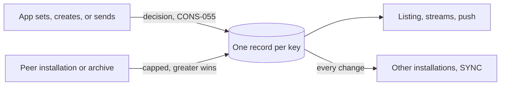

# Consent

Consent decides what a user sees. An allowed conversation is listed, streamed, and pushed. A denied one is hidden. An unknown one is listed as a request, so the user can decide on it.

Every installation of the user's inbox can decide, and installations never coordinate. They exchange records over the sync group (`SYNC`) and through archives (`ARCH`). Four rules give every installation the same answer, in any order:

1. **One record per conversation.** A group's record is keyed by its group id. A DM's record is the other member's inbox record, so one decision covers every DM with that person (CONS-052).
2. **The greater record wins.** Records compare by consent time, then by state: denied over allowed over unknown (CONS-053).
3. **A received time is capped** at one day after the envelope time of the sync message that carries it, or, from an archive, one day after the current time (CONS-054).
4. **A decision comes after what this installation has seen**, so the newest decision wins even on a slow clock (CONS-055).

Only the user stores allowed or denied: by deciding, by creating a conversation, or by sending in one. A join stores nothing, and that includes a join after a removal (CONS-058).



Non-goal: a backend that falsifies envelope times. CONS-054 uses them as given.

## Scope

In scope: consent states, keys, the wire form, which record wins, what the client stores on its own, how consent filters listings and streams, and what an SDK exposes.

Out of scope: how records travel and when they are published (`SYNC`), the dm id and the peer of a DM (`DMS`), stream delivery (`PROC`), push (`PUSH`), readd requests (FORK-053, FORK-080), and the archive container (`ARCH`).

A device clock that is more than a day off is out of scope.

| Related | Relation |
| --- | --- |
| `SYNC` | Carries records between installations. SYNC-027 marks the changes to publish. |
| `DMS` | Owns the dm id (DMS-001), the peer of a DM (DMS-017), and the group an app sees for a DM (DMS-007). |
| `JOIN` | Owns the join. CONS-058 owns what a join stores: nothing. |
| `PUSH` | Owns which conversations produce push notifications. It reads conversation consent. |
| FORK-053, FORK-080 | Own acceptance and response to readd requests, including consent checks. |
| `ARCH` | Owns the archive. An imported record is merged under CONS-053. |
| `MIG` | Converts a pre-8.0 database. MIG-009 writes a peer's DM rows as one inbox record under CONS-061. |
| `EVENT` | EVENT-001 owns `consent.changed` emission. EVENT-030 and EVENT-031 own queue loss and the `lagged` report. |

## Terms

| Term | Meaning |
| --- | --- |
| Consent record | A key, a state, and a consent time. |
| Key | What a record is about: a group or an inbox. CONS-052 defines it. |
| Conversation consent | The record CONS-052 assigns to a conversation. For a DM, it is the other member's inbox record. |
| Consent time | When the state was decided, in nanoseconds since the Unix epoch. |
| Decision | A record the client stores because the user acted: CONS-055, CONS-056, or CONS-057. |
| Merge | Storing a record that carries its own time, under CONS-053. |
| Consent filter | The set of states an app passes when it lists or streams conversations or messages. An absent filter and an empty filter are different things. |
| Listing time | The time a conversation listing orders by: a conversation's creation time when the app orders by creation, and its last-activity time under CONS-048 otherwise. |

## 1. Records and keys

A record is unknown, allowed, or denied. Unknown is both a stored state and the state of a key with no record; an app and a filter cannot tell them apart. Conversation consent gates listing and streaming (section 4), push (`PUSH`), and readd requests (FORK-053, FORK-080). An inbox record is also the consent of every DM with that inbox.

Peers (`SYNC`) and archives (`ARCH`) share one wire form:

```proto
message ConsentSave {
  ConsentTypeSave entity_type = 1;
  ConsentStateSave state = 2;
  string entity = 3;
  int64 consented_at_ns = 4;
}

enum ConsentTypeSave {
  CONSENT_TYPE_SAVE_UNSPECIFIED = 0;
  CONSENT_TYPE_SAVE_CONVERSATION_ID = 1;
  CONSENT_TYPE_SAVE_INBOX_ID = 2;
  CONSENT_TYPE_SAVE_ADDRESS = 3 [deprecated = true];
}

enum ConsentStateSave {
  CONSENT_STATE_SAVE_UNSPECIFIED = 0;
  CONSENT_STATE_SAVE_UNKNOWN = 1;
  CONSENT_STATE_SAVE_ALLOWED = 2;
  CONSENT_STATE_SAVE_DENIED = 3;
}
```

| ID | Title | Requirement | Why |
| --- | --- | --- | --- |
| CONS-001 | No record is unknown | When an app reads the consent of an entity, or a consent filter is applied to a conversation, the client MUST report and filter an entity with no record as unknown. | |
| CONS-050 | One wire form | When the client encodes a record for a peer installation or an archive, it MUST encode it as the `ConsentSave` above, with `entity_type` conversation for a group key and inbox for an inbox key, `entity` set to the key under CONS-052, and `state` and `consented_at_ns` set to the record's values. | Two installations that encode one key differently hold two records and never merge them. |
| CONS-051 | Skip an unusable record | When a received or imported `ConsentSave` has `entity_type` `CONSENT_TYPE_SAVE_UNSPECIFIED` or `CONSENT_TYPE_SAVE_ADDRESS`, `state` `CONSENT_STATE_SAVE_UNSPECIFIED`, or an `entity` longer than 256 bytes, the client MUST NOT store it and MUST go on with the other records. | An archive from early 2025 can hold address records, and failing on one loses every record after it. A record too large for a sync message would stop every publish behind it. |
| CONS-052 | One record per conversation | The client MUST key the consent of a group by its group id in lowercase hexadecimal, of an inbox by its inbox id in lowercase, and of a DM by the inbox id of its other member under DMS-017, as an inbox record; a DM whose dm id does not name the own inbox has no key. When an app sets the consent of a conversation by group id, the client MUST use the key of the conversation it holds under that id, and MUST return an error and store nothing when it holds none. Any other record MUST be stored under the key it names, except as CONS-061 moves it. | Either inbox can start another group for a DM at any time, and a block stored per group leaves the new group unblocked. A record stored under a group id the client does not hold is never read by a DM that arrives later. Moving it then would let a former member of a group, who can build a DM with that group's id (JOIN Known limitations), take over the user's decision about the group. |

## 2. Which record wins

Applied in any order, and any number of times, a set of records leaves the same record on every installation that has seen them all.

| ID | Title | Requirement | Why |
| --- | --- | --- | --- |
| CONS-053 | The greater record wins | When the client merges a record, it MUST store it when the key has no record, or when its consent time is greater than the stored one, or when the times are equal and its state is greater, with denied over allowed over unknown; otherwise it MUST leave the stored record unchanged. | One order on records gives every installation the same answer whatever order records arrive in. |
| CONS-054 | A received time is capped | When the client merges a record whose consent time is more than one day after the envelope time of the sync message that carries it, or, from an archive, more than one day after the client's current time, it MUST merge it with that limit as its consent time. | A time far ahead would beat every later decision. Measured from the envelope time, the limit gives every receiver the same value whatever its clock. A record that is capped, not refused, still arrives. |
| CONS-055 | A decision comes after what was seen | When an app sets the consent of a key, or the client stores allowed under CONS-056 or CONS-057, the client MUST store the state at the greater of its current time and the stored consent time plus one nanosecond, even when the state is unchanged. | A decision must beat every record its installation saw, even on a slow clock. A repeated decision must move the time forward, or it loses to one made elsewhere in between. |

## 3. What the client writes

| When | The client stores | Rule |
| --- | --- | --- |
| The app sets a state | That state, as a decision | CONS-055 |
| The app creates a group or a DM | Allowed, as a decision, unless the user already decided | CONS-056 |
| The app sends a message, other than a deletion or a leave request | Allowed, as a decision, unless it already reads allowed | CONS-057 |
| A Welcome adds the user, for the first time or again | Nothing | CONS-058 |
| A peer or an archive sends a record | The record, capped and merged | CONS-053, CONS-054 |

| ID | Title | Requirement | Why |
| --- | --- | --- | --- |
| CONS-056 | Creating allows | When the client creates a group or a DM at an app's request and the conversation's record is absent or unknown, it MUST store allowed for it under CONS-055. | A conversation the user started must not be a request. A DM with a person the user blocked stays blocked when the app opens it again. |
| CONS-057 | Sending allows | When the client queues a message an app sent, other than a message deletion or a leave request, in a conversation that does not read allowed, it MUST store allowed for it under CONS-055, in the transaction that queues the message. When it reads allowed, the client MUST NOT store a record. | A conversation the user replied in must not stay a request. An allow stored after the send is lost if the process ends first. A record stored on every send is published on every send. Leaving is not a reply. |
| CONS-058 | Joining stores nothing | When the client completes a join from a Welcome, including a join to a group it was removed from or left, it MUST NOT store a consent record. | Another inbox chooses whom to add and whom to add back, and a group can name anyone as its creator. A removed installation cannot tell a re-add from a second MLS group that a former member built under the same id (JOIN-083), so a re-add changes nothing the user decided. |

## 4. Gating listing and streaming

An app can filter conversation listings and streams by consent state. The client returns or delivers only conversations in the requested states, and a conversation with no record counts as unknown (CONS-001). An empty filter names no state and so includes nothing; it is not the same as no filter. Without a filter, a listing and a message stream across conversations include allowed and unknown conversations. A conversation stream without a filter includes every consent state. PROC-047 owns default delivery progress when a message filter excludes a candidate.

A message listing within one conversation is not filtered: the app named the conversation. A sync group is never listed or streamed unless the app asks for sync groups (SYNC-005).

| ID | Title | Requirement | Why |
| --- | --- | --- | --- |
| CONS-060 | The filter is on conversation consent | When an app lists or streams conversations, or streams messages across conversations, with a consent filter, the client MUST include only conversations whose conversation consent under CONS-052 is in the filter, so that an empty filter includes none. | A DM's consent is its peer's inbox record. A filter that reads only group records would list a blocked person's DMs. |
| CONS-031 | Default listing excludes denied | When an app lists conversations with no consent filter, the client MUST return the conversations whose conversation consent is allowed or unknown and MUST NOT return one whose consent is denied. | A denied conversation that appears is the block failing; an unknown one that disappears can never be decided on. |
| CONS-042 | Default all-message stream | When an app streams messages across all its conversations with no consent filter, the client MUST deliver only messages from conversations whose conversation consent is allowed or unknown, as CONS-031 does for listings. | Messages from a denied conversation must not reach an app that used the default consent choice. |
| CONS-043 | One conversation stream | When an app streams messages from one named conversation with no consent filter, the client MUST NOT filter that stream by the conversation's consent state. | The app has selected that conversation explicitly. |
| CONS-044 | Default conversation stream | When an app streams conversations with no consent filter, the client MUST deliver new conversations of every consent state. | An app that hides a new denied conversation cannot show it in a blocked list. |
| CONS-046 | Conversation page size | When an app lists conversations, an SDK MUST return at most the `limit` the app names, or at most 100 conversations when the app names none, and MUST fail the call with an invalid-argument error when `limit` is less than 1 or greater than 1000. | The default listing includes unknown conversations (CONS-031), so without a page size one call returns every conversation that any stranger creates for the user. |
| CONS-047 | Pages resume after ties | When an app lists conversations with a before time and a conversation id, an SDK MUST return only conversations whose listing time is less than that time, or equal to it with a group id lower in byte order than that conversation's group id. | A cursor of time alone skips every conversation that shares the boundary time, and a sender can give many conversations the same last-activity time. |
| CONS-049 | Pages are ordered | When an app lists conversations, an SDK MUST return the matching conversations in order of descending listing time and then descending group id in byte order, starting with the first that CONS-047 admits, up to the page size of CONS-046, where the listing time is the creation time in creation order and the CONS-048 time in activity order; when the app names a before conversation id without a before time, the SDK MUST fail the call with an invalid-argument error. | A page that may hold any matching subset, or that orders ties by ascending id, skips or repeats every conversation that shares the boundary time, even with the CONS-047 cursor. |
| CONS-048 | Activity time matches the listing | When an app reads a conversation's last-activity time without naming content types, an SDK MUST return the greatest send time among the conversation's unexpired application messages that an activity-ordered listing counts, or its creation time when there is none. An activity-ordered listing MUST use that same time as its listing time under CONS-049. | An app pages an activity-ordered listing with this time, and a time that counts an expired message names a later boundary than the listing used and returns the same conversations again. |

## 5. What an app can read and set

An app reads consent to build its inbox and its request list, sets it when the user decides, and follows changes that arrive from the user's other installations. A `consent.changed` event tells the app to read the record again. If the event queue discards a change, EVENT-031 reports it through `lagged`. An app names conversations by group id, so a DM is also reported under the group the app lists.

| ID | Title | Requirement | Why |
| --- | --- | --- | --- |
| CONS-041 | Read set and follow consent | An SDK MUST let an app read and set the consent of a conversation and of an inbox, and subscribe to `consent.changed` events under EVENT-001, subject to EVENT-030 and EVENT-031. | An app cannot update its view after a change on another installation without a change signal. |
| CONS-059 | Apps see group ids | When an SDK reports a change to an inbox record in an event or a stream, it MUST also report it for the DM with that inbox, named by the group id that DMS-007 returns, when the client holds one. It MUST NOT report a change to a group record as a change to a conversation whose CONS-052 key is a different record. When it reports a DM's consent in a read, it MUST report the conversation consent of CONS-052. | An app keys conversations by group id and redraws a DM only when its group id is reported. An event must agree with the read that follows it. |

## 6. Records written before 8.0

Before 8.0, a DM's consent was its group's record, and inbox records decided no DM. The time of a pre-8.0 record is when the row was first created, not when its state was last set. So the time of a DM record and the time of an inbox record cannot say which decision is newer.

| ID | Title | Requirement | Why |
| --- | --- | --- | --- |
| CONS-061 | Pre-8.0 DM records | When the client receives or imports a record that names a 16-byte group id held as a DM, it MUST store the record under that DM's key under CONS-052. When an archive carries a 16-byte DM group that the client holds, whether or not its import stored it, the client MUST combine the archive's records for every 16-byte DM it holds with that DM's peer and the archive's inbox record for the peer into one inbox record whose state is the strongest of theirs, denied over allowed over unknown, and whose consent time is the greatest of their times. When the client restores a 16-byte DM while it holds a record under that DM's group id, it MUST merge the record into the DM's key under CONS-053 and remove it. | An archive written before 8.0 names a DM by its 16-byte group id, which no Welcome can activate (JOIN-083), so moving it cannot give another inbox control of the record. Pre-8.0 times are first-insert times, so they cannot order the rows; the strongest state never weakens a block the user saw, in either the DM or the inbox read. The greatest time lets the combined record replace each of its sources, and the same archive imported twice gives the same record. |

## Known limitations

Two installations that decide on one key without seeing each other's decision are ordered by their clocks. The decision made later in real time loses when its installation's clock is behind.

A compromised own installation can store a record up to a day after its message's envelope time before it is revoked; the user's next decision replaces it.

A join stores nothing. When another inbox removes the user from a group and adds the user back, or a former member builds a second MLS group under its id (JOIN-083), the conversation keeps the user's earlier decision, including an allow.

An archive written before 8.0 stores each record at the time its row was first created, not the time of its latest state, and rows older than 2025 at time 0. Between two such group records, or two such inbox records, for one key, the later-created row wins. CONS-061 combines a peer's DM records only within one archive; across two archives, they merge by time. The combined record keeps the strongest state, so a DM the user allowed reads denied when another DM with that person, or that person's inbox, read denied. When such an archive leaves out a DM's group, the DM's record names a 16-byte group id that nothing reads until that DM is restored. Those clients also allowed a group whose creator field named the user, and the archive carries that allow as a decision.

An app cannot set the consent of a conversation the client does not hold yet. It can set the consent of the other member's inbox, which covers every DM with that person.

Inbox consent decides DMs only. Denying an inbox hides its DMs but not the groups it adds the user to; only a group's own record does.

A DM restored from another inbox's archive has a dm id that does not name the own inbox (DMS-017). It has no key, reads unknown, and cannot be set.

In activity order, a conversation whose last-activity time changes between two pages, because a message arrives or expires, can be returned twice or skipped. In creation order, a group's creation time does not change, so each conversation is returned once, with two exceptions. A DM whose listed group changes between two pages, because a message arrives in another group for the same DM identifier (DMS-007, DMS-013), is then listed with that group's id and creation time, so it can be returned twice or skipped. A restored group whose Welcome arrives between two pages takes the Welcome's processing time as its creation time, so it can be skipped.
