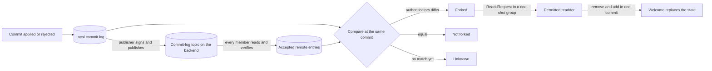

# Fork recovery and the commit log

Members of one group can hold different MLS states for the same epoch: one applied a commit that another rejected, or two clients merged the same commit onto different trees. A member in that condition is forked. It can no longer decrypt what the others send, and nothing in MLS tells it so. The commit log is the record that does. Publishers append to a per-group log on the backend a signed entry for every commit they apply or reject, with the epoch authenticator that resulted. Every member compares its own record against that log. A member whose authenticator differs from the log's at the same commit is forked, and asks the group's permitted readders to remove and re-add it.

The repair is a remove-and-add commit and the Welcome it produces. It restores a member that can still process the removal commit, which is the case when the member's log diverged before its epoch secrets did, or when the readder's commit is the first the member cannot apply. A member whose epoch secrets have already diverged cannot decrypt the removal, stays active in its own view, and refuses the Welcome under JOIN-042. This spec does not promise to repair that member; the Known limitations say why.

The log is sound only while its entries are complete, ordered, and signed under one key per group. The rules here are what make that hold.



## Scope

In scope: the entries a client records for each commit outcome; the keys an entry is sealed under and how a reader opens it; who publishes entries and in what order; how a client verifies and accepts remote entries; the fork state and how it is computed; readd requests, the one-shot groups that carry them, and who may act on them; the readd commit; the recovery policy an app sets; and what an app can read.

Out of scope: commit validation, the membership component, and the protocol-version hold (GMOD-021, GMOD-005, GMOD-025), ordered topic processing and terminal rejection (PROC-005, PROC-011), the publish and query contract, sequence ids, and the admission of a commit-log entry (`API`), the topic layout (`TOPIC`), retention (`OPS`), the super admin role and proposal authorization (`PERM`), consent (`CONS`), the metadata components this spec uses (`META`), when a Welcome replaces existing group state (JOIN section 7), and the deployment switch that turns the log on (CONF-045).

| Related | Relation |
| --- | --- |
| `CONF` | Owns `commit_log_enabled` and CONF-045, the switch that turns publishing and reading off for a deployment. |
| `JOIN` | Owns whether a Welcome replaces state the client already holds (JOIN-092, JOIN-042 to JOIN-044), the adder read from the ratchet tree (JOIN-025), and key-package validation (JOIN-007, JOIN-008, JOIN-082). A readd is repaired by that path. |
| `API` | Owns `ClientEnvelope` and its `sealed_commit_log_entry` payload, sequence ids (API-286 through API-289), the prefix a read returns (API-201), and the admission of a commit-log entry (API-230). |
| `TOPIC` | Owns the commit-log kind byte and its 32-byte commit-log identifier (TOPIC-001, TOPIC-002). |
| `OPS` | Owns retention. API-212 assigns commit-log expiry; OPS-001 prevents deletion of an exempt envelope. |
| PERM-001, GMOD-052 | Own the super admin role and the same-installation readd exception used by FORK-062. |
| [CONS section 1](CONS-consent.md#1-states-and-entities) | Defines the conversation consent state tested by FORK-085, FORK-030, and FORK-053. |
| [META section 2](META-group-metadata.md#2-well-known-components) | Owns the `GROUP_ROOT_KEY`, `ONESHOT_MESSAGE`, and minimum protocol version components. This spec states their use. |
| GMOD-040, GMOD-041 | Own the group root and the commit-log keys derived from it. |
| `ARCH` | Owns restored groups (ARCH-015). A restored group holds no group root, so it has no commit-log id, and FORK-030 does not read it. |
| GMOD-021, GMOD-025 | Own commit validation and the hold below a group's minimum protocol version. |
| PROC-011, PROC-012 | Own terminal rejection, which FORK-002 records, and unresolved work, which it does not. |
| `EVENT` | EVENT-001 reports when a conversation's fork state becomes forked. |

## Terms

| Term | Meaning |
| --- | --- |
| Epoch authenticator | The `epoch_authenticator` of a group's key schedule ([RFC 9420 §8](https://www.rfc-editor.org/rfc/rfc9420.html#section-8)). It identifies the encryption state after a commit and is not secret. |
| Commit sequence id | The sequence id of a commit's envelope on the group's message topic. |
| Local entry | One `LocalCommitLogEntry` (section 1) that a client records for a commit outcome. |
| Removal entry | A local entry for a commit that removed the recording installation. It carries the pre-commit epoch as its applied epoch. |
| Membership | The span from one installation of a group's state, by creation, a Welcome, or an archive restore, to the next. Local entries from an earlier membership are not compared. |
| Entry | A commit-log entry: a `PlaintextCommitLogEntry` (section 2), which a publisher seals into a `SealedCommitLogEntry` (FORK-074). |
| Commit-log topic | The topic of a conversation's entries, named by its commit-log id (TOPIC-001). |
| Publisher | An installation whose leaf node names an inbox in the conversation's `DM_MEMBERS`, for a DM, or in its super admin list, for a group. |
| Legacy local history | Local commit-log entries recorded by a client that did not yet support author-signed entries under FORK-076. |
| Connected legacy suffix | The longest suffix of local entries that can be followed backward from the current MLS epoch and epoch authenticator through consecutive applied states, stopping at the current membership start or the first missing or inconsistent state transition. Rejected entries retain the same epoch and authenticator. A removal entry is excluded and stops the suffix. A zero-sequence membership marker identifies the current membership start only when this backward proof reaches its recorded state. |
| Retained role evidence | A `GroupUpdated` record the client created when it applied an MLS commit, associated with that commit's group and sequence id. An application message whose content claims to be `GroupUpdated` is not retained role evidence. |
| Unresolved role commit | An applied commit in legacy local history whose recorded change classification permits a super-admin-list change, or is absent or unrecognized, and for which retained role evidence is absent or cannot be decoded. |
| Legacy reader epoch floor | A persistent minimum `applied_epoch_number` for entry admission, initialized under FORK-088; zero is an initialized value. |
| Publisher boundary | The group-message sequence position for a publisher that FORK-089 uses when testing continuity. |
| Accepted entry | An entry a client read from the commit-log topic and kept under FORK-077, FORK-087, and FORK-083. |
| Fork state | One of `forked`, `not forked`, or `unknown`, held for each conversation and set under section 5. |
| Readd request | A `ReaddRequest` (section 6): a forked installation's request to be removed and added back. |
| One-shot group | A group whose conversation type is one-shot: it carries one `OneshotMessage` in its immutable metadata and never carries an application message. |
| Permitted readder | An inbox whose installations receive a readd request and may act on it, per the table in section 6. |
| Readd commit | The commit under FORK-062 that removes an installation and adds it back. |
| Recovery policy | The app-supplied choice of which conversations a client sends readd requests for. |

## 1. The local commit log

Every commit a client merges or rejects with a terminal outcome leaves one local entry. The entry records the commit's sequence id, the epoch authenticator before it, the result, and the epoch and authenticator after it. A commit that removes the recording installation is a removal entry: the member merges only the public part of that commit and cannot derive the new epoch's secrets, so the entry keeps the pre-commit epoch. A removal entry is neither published nor compared.

A failure is recorded only when it is terminal. PROC-011 and PROC-012 distinguish terminal rejection from unresolved work; a held commit has no outcome yet, and recording one would publish a rejection the group never made.

CONF-045 forbids publishing and reading while a deployment's `commit_log_enabled` is `false`. This spec adds that such a client records no local entries and reports every fork state as `unknown` (FORK-004), so that a log that was never kept is not read as evidence.

```webidl
dictionary LocalCommitLogEntry {
  required sequence<octet> group_id;                    // 16 or 32 bytes
  required unsigned long long commit_sequence_id;
  required sequence<octet> last_epoch_authenticator;
  required CommitResult commit_result;                  // the wire enum of section 2
  required unsigned long long applied_epoch_number;     // unchanged when the commit was not applied
  required sequence<octet> applied_epoch_authenticator; // unchanged when the commit was not applied
  required boolean removed_this_installation;           // true for a removal entry
};
```

The result a terminal failure records is the first row below whose condition holds.

| Failure | `commit_result` |
| --- | --- |
| The commit's `epoch` is not the group's current epoch | `COMMIT_RESULT_WRONG_EPOCH` |
| The commit's payload cannot be decrypted or fails MLS processing for another reason | `COMMIT_RESULT_UNDECRYPTABLE` |
| The commit decrypts and fails validation under GMOD-021 | `COMMIT_RESULT_INVALID` |

| ID | Title | Requirement | Why |
| --- | --- | --- | --- |
| FORK-001 | Record every applied commit | While `commit_log_enabled` is `true`, when the client merges a commit into a group's MLS state and its installation is a member after the merge, the client MUST record a local entry whose `commit_sequence_id` is the commit sequence id, whose `last_epoch_authenticator` is the group's epoch authenticator before the merge, whose `commit_result` is `COMMIT_RESULT_APPLIED`, and whose `applied_epoch_number` and `applied_epoch_authenticator` are the group's epoch and epoch authenticator after it. | A commit without an entry can never be compared, so a fork at that commit is read as `unknown` for ever, and a publisher that skips it ends the log for every member under FORK-083. |
| FORK-002 | Record only a terminal failure | While `commit_log_enabled` is `true`, when the client records a terminal rejection for a commit under PROC-011, it MUST record a local entry with the `commit_result` the table above gives and with `applied_epoch_number` and `applied_epoch_authenticator` equal to the group's current values, and MUST NOT record an entry for a commit it holds for a later attempt. | A held failure recorded as terminal publishes a rejection the group never made, and every member that applied the commit then reads itself as forked. |
| FORK-004 | No log, no evidence | While `commit_log_enabled` is `false`, the client MUST report every conversation's fork state as `unknown`. | A `not forked` read from an empty log tells an app a broken conversation is healthy. |

## 2. Keys and signatures

Entries are encrypted and signed. Three keys serve a conversation's log, all derived from its group root under GMOD-041. The commit-log signing key signs every entry, the commit-log encryption key encrypts it, and the commit-log nonce key derives its nonce. Every installation that holds a conversation's MLS state received the root with the creation or Welcome that installed it, so every member can read the log, whether or not it is forked. The commit-log id names the topic (TOPIC-001). It is the only key a reader verifies an entry's outer signature under, and no entry can change it. A group whose id is 16 bytes has no commit-log id, and so no log to read.

The nonce is derived from the topic and the entry, so the same entry sealed twice is the same bytes, and a retry is a duplicate under API-222. This is a deterministic use of RFC 8439, in the style of SIV ([RFC 5297](https://www.rfc-editor.org/rfc/rfc5297)). RFC 8439 §2.8 asks for a nonce that is unique for each invocation, and its §4 rejects truncated wide outputs as nonces because they can repeat. Here a repeat for identical input is intended. For distinct entries of one conversation, a repeat has probability at most q(q−1)/2^97 for q entries, about 2^-57 at a million entries. A repeat would reveal the XOR of the two entries to readers of the topic, and would allow AEAD forgeries under that nonce, which the signature checks in FORK-077 still reject.

`API` owns `xmtp.backend.v1.SealedCommitLogEntry` as a payload of `ClientEnvelope`. It is shown here because FORK-074 states what its fields carry. `xmtp.mls.message_contents.CommitLogEntry`, an older message with a `sequence_id` field, is not used on this backend.

```proto
// xmtp.backend.v1
// A commit-log entry, encrypted and signed under keys derived from the
// group root.
message SealedCommitLogEntry {
  // 32-byte public key of the commit-log signing key. Derives the topic.
  bytes commit_log_id = 1;
  // 12 bytes.
  bytes nonce = 2;
  // ChaCha20-Poly1305 encryption of a serialized PlaintextCommitLogEntry.
  bytes ciphertext = 3;
  // 64-byte Ed25519 signature [R(32) || S(32)] over CommitLogEntryTBS by
  // the commit-log signing key.
  bytes signature = 4;
}
```

```proto
// xmtp.mls.message_contents
enum CommitResult {
  COMMIT_RESULT_UNSPECIFIED = 0;
  COMMIT_RESULT_APPLIED = 1;
  COMMIT_RESULT_WRONG_EPOCH = 2;
  COMMIT_RESULT_UNDECRYPTABLE = 3;
  COMMIT_RESULT_INVALID = 4;
}

// PlaintextCommitLogEntry indicates whether a commit was successful or not,
// when applied on top of the indicated `last_epoch_authenticator`.
message PlaintextCommitLogEntry {
  // The group_id of the group that the commit belongs to.
  bytes group_id = 1;
  // The sequence ID of the commit payload being validated.
  uint64 commit_sequence_id = 2;
  // The encryption state before the commit was applied.
  bytes last_epoch_authenticator = 3;
  // Indicates whether the commit was successful, or why it failed.
  CommitResult commit_result = 4;
  // The epoch number after the commit was applied, if successful.
  uint64 applied_epoch_number = 5;
  // The encryption state after the commit was applied, if successful.
  bytes applied_epoch_authenticator = 6;
  // The 32-byte installation key of the installation that published this
  // entry: the signature_key of its leaf node.
  bytes author_installation_key = 7;
  // 64-byte Ed25519ph signature by author_installation_key (FORK-076).
  bytes author_signature = 8;
}
```

| ID | Title | Requirement | Why |
| --- | --- | --- | --- |
| FORK-074 | Seal each entry | When the client publishes an entry, it MUST publish a `SealedCommitLogEntry` whose `commit_log_id` is the conversation's commit-log id and whose `nonce` is the first 12 bytes of the HMAC-SHA256, under the commit-log nonce key, of the commit-log topic followed by the encoding of the `PlaintextCommitLogEntry` that writes each field whose value is not the default once, in ascending field-number order, and no other bytes. Its `ciphertext` MUST be the ChaCha20-Poly1305 ([RFC 8439](https://www.rfc-editor.org/rfc/rfc8439)) encryption of that same encoding under the commit-log encryption key, with that nonce and with the commit-log topic as associated data. Its `signature` MUST be the publish signature of `CommitLogEntryTBS` under the commit-log signing key. | A nonce taken from anything but the topic and the entry makes a retried entry a second stored copy, or puts two inputs under one nonce and key. An entry under any other key is discarded by every reader. |
| FORK-076 | Sign each entry as its author | When the client publishes an entry, it MUST set its `author_installation_key` to its own installation key and its `author_signature` to the Ed25519ph signature ([RFC 8032 §5.1](https://www.rfc-editor.org/rfc/rfc8032#section-5.1)) under that key, with context `XMTP commit-log author v1`, of the commit-log topic followed by the encoding FORK-074 defines of that entry with `author_signature` empty. | Every reader discards an entry whose author signature fails (FORK-077), so a publisher that omits it leaves the conversation with no log. |

## 3. Publishing entries

A publisher appends its local entries to the conversation's commit-log topic in the order it recorded them. A reader requires an entry to continue the previous accepted entry except where FORK-083 permits a new chain. A publish that fails, or whose response does not confirm an entry, is retried from that entry before anything later is sent. Removal entries are never published: a removal entry does not attest the epoch the remaining members moved to.

The backend routes an entry by its `commit_log_id` (TOPIC-001). It refuses the entry unless its signature passes API-300 (API-230), assigns it a sequence id (API-286 through API-289), and stores it. It cannot decrypt it. A read returns a prefix of the topic in sequence id order (API-201), and a commit-log entry never expires (OPS-001), so the order every member reads is the order every member reads.

A client upgrading legacy local history may hold a publisher flag that predates later role changes. Publication eligibility comes from its current MLS state and its current role's start, rather than from that old flag. The client's retained role evidence can identify a promotion that happened after the current membership began.

Administrative message clearing can remove that evidence while preserving local commit-log entries. Logging disabled during a commit or replacement Welcome can also leave a gap in the recorded states. Recovery first limits history to the connected legacy suffix; an older zero-sequence marker by itself does not establish the current membership. Where the evidence cannot distinguish a role change from another applied change, recovery keeps the suffix whose eligibility follows from the current role and the remaining evidence. It omits the uncertain earlier entries. It does not move publication progress backwards. This is a one-time rule for legacy local history; ordinary subsequent role changes keep the current-role rule.

The connected-suffix state-proof table computes the connected suffix in reverse local recording order. Start `(E, A)` at the current MLS epoch number and epoch authenticator. Each row below describes the next older local record. A mismatch excludes that record and all earlier records. A state match compares the complete authenticator bytes.

| Record | State proof and stopping rule |
| --- | --- |
| Removal entry | Stop before including this record, even if its retained pre-removal state matches. |
| Zero-sequence membership marker | Stop without publishing this marker. It establishes the membership start only if its applied epoch number and applied authenticator equal `(E, A)`; otherwise the earlier prefix remains unproved. |
| Applied entry | Require `(applied_epoch_number, applied_epoch_authenticator) = (E, A)` and `E > 0`. Include it and continue with `(E − 1, last_epoch_authenticator)`. |
| Rejected entry | Require `applied_epoch_number = E` and both `last_epoch_authenticator` and `applied_epoch_authenticator` equal `A`. Include it and continue with unchanged `(E, A)`. |

The legacy recovery boundary table selects the boundary within the connected legacy suffix. If that suffix is empty, no legacy entry is eligible. A position in the table refers to the corresponding local entry, and that entry is included in the suffix. The entry of a promotion is included just as it is during normal operation.

| Conversation | Legacy recovery boundary |
| --- | --- |
| DM | The start of the connected legacy suffix. Both members are publishers throughout that membership. |
| Group with a retained own-inbox super-admin promotion or an unresolved role commit in the connected legacy suffix | Whichever of those commits has the greatest commit sequence id. A retained promotion is identified by the client's inbox in `GroupUpdated.added_super_admin_inboxes`. |
| Group with neither such commit | The start of the connected legacy suffix. |

Retained role evidence after the chosen boundary is what rules out a later loss of the current role. A publisher's continuing role cannot be inferred from its cached flag. The last unresolved commit itself is included: the current role and the absence of a later role transition establish its post-commit role, while the uncertainty concerns the earlier prefix.

A recorded classification that permits changes to group membership, permissions, or administrator lists permits a super-admin-list change for this purpose: one applied commit can combine those changes. A classification confined to a key update or to non-role metadata does not. A rejected commit does not change the role. These classifications describe the retained local evidence; the internal enum and storage layout remain outside the spec.

| ID | Title | Requirement | Why |
| --- | --- | --- | --- |
| FORK-085 | Publish from the current role | While `commit_log_enabled` is `true`, a conversation's consent state is allowed, and the client is a publisher of that conversation, it MUST publish an entry for each local entry, other than a removal entry, that it recorded in its current membership since it last became a publisher, with `group_id`, `commit_sequence_id`, `last_epoch_authenticator`, `commit_result`, `applied_epoch_number`, and `applied_epoch_authenticator` equal to the local entry's values of the same name, and MUST NOT publish any other local entry, except that legacy local history is subject to FORK-086. The local entry of the commit that made it a publisher counts as recorded since then. | A publisher that skips an eligible entry can leave readers without evidence, while entries from an earlier membership or role can precede a gap and duplicate permanent log history. |
| FORK-086 | Recover legacy publication eligibility | When publication eligibility for legacy local history has not yet been recovered, before the first publication attempt or first subsequent applied commit, the client MUST retain for publication exactly the suffix selected by the connected-suffix state-proof table and the legacy recovery boundary table if its current MLS role permits publication, subject to existing publication progress and the other conditions of FORK-085. It MUST publish those eligible legacy entries while the enable, consent, and actual-role conditions in FORK-085 hold, and MUST NOT publish a legacy entry preceding that boundary. The client MUST preserve recorded publication progress and its resulting eligibility through restart. | An idle promoted publisher otherwise remains excluded, and treating flag repair as a promotion permanently skips pending entries, including in a DM whose authority never changed. |
| FORK-021 | No gaps, in order | The client MUST publish a conversation's entries in ascending `commit_sequence_id` order, and when a publish request fails or its response does not carry a sequence id greater than 0 for an entry, it MUST publish that entry again before it publishes any later entry of that conversation. | An entry published ahead of one the backend never stored is discarded by every reader under FORK-083, and the missing one can never be inserted behind it. |

## 4. Reading the remote log

Every member reads the commit-log topic of each DM and group it holds and verifies each entry before it counts. Verification has three parts. The signatures, the decryption, and the identity of the entry tie it to the conversation's commit-log id, its group, and the installation that wrote it. The author check ties it to a publisher in the reader's own ratchet tree, once the reader has processed the commit the entry names. The chain rules tie it to the previous accepted entry: sequence ids increase, an applied commit starts from the authenticator the last one produced and advances the epoch by one, and a rejected commit leaves both unchanged. An entry that fails any part is discarded and never counts, however often it is read.

An entry that fails FORK-077 is discarded whoever published it, and the backend refuses one whose signature fails before storing it (API-230, API-300). That stops anyone who never held the root. Every installation that was ever a member holds it, so the root alone does not make an installation a publisher: each entry names its author and is signed by that installation, and a reader keeps it only when its own ratchet tree shows the author is a publisher. A reader judges that once it has processed the commit the entry names, so an entry from a newly promoted publisher waits instead of being lost, and when the author of the last accepted entry stops being a publisher, the next publisher's entry starts the chain again. A publisher that returns after losing the role, or after removal and readd in the same commit, has a new publisher boundary. An entry at or after that boundary can start a chain after an accepted entry from before it.

A reader's membership also sets a publisher boundary from the Welcome's authenticated group-message anchor (JOIN-036 through JOIN-038). The anchor gives a reader that joined after earlier publisher changes a point from which it can compare the log. Publisher boundaries survive a client restart. Accepted entries and the sticky fork state remain subject to section 5.

The chain conditions a reader applies once it holds an accepted entry for the conversation:

| `commit_result` of the entry | Condition on the last accepted entry |
| --- | --- |
| Any | `commit_sequence_id` is greater than the last accepted entry's `commit_sequence_id` |
| `COMMIT_RESULT_APPLIED` | `last_epoch_authenticator` equals the last accepted entry's `applied_epoch_authenticator`, when that is non-empty, and `applied_epoch_number` equals the last accepted entry's `applied_epoch_number` plus 1 |
| Not `COMMIT_RESULT_APPLIED` | `applied_epoch_number` and `applied_epoch_authenticator` equal the last accepted entry's |

A legacy reader may not retain the Welcome anchor or every publisher return it processed before upgrade. It therefore records a one-time minimum applied epoch before its first later merge or remote-entry evaluation. Entries from lower applied epochs are discarded, while the existing authority, hold, and continuity checks apply to the rest. The floor uses the current public group-context epoch even for an inactive reader: that reader cannot derive post-removal MLS secrets, but can still verify commit-log envelopes under the persistent group root. Application messages do not advance this epoch.

Creation and every validated Welcome set the floor to zero. A Welcome provides an authenticated publisher boundary for its new membership. Ordinary processing and restart preserve the initialized floor until that reset. Legacy initialization preserves existing accepted entries and sticky fork state.

The boundary-initialization table supplies the initial value and the later commits counted by FORK-089:

| Boundary initialization | Initial boundary for each current publisher | Later role/readd commits considered |
| --- | --- | --- |
| Creation | Zero. | Commits applied in that membership. |
| Welcome installation | Its authenticated `message_cursor` (JOIN-036 through JOIN-038). | Commits applied after that Welcome. |
| Legacy reader initialization under FORK-088 | Its previously recorded publisher boundary, or zero if none was recorded. Earlier unrecorded role/readd positions and the earlier Welcome anchor are omitted. | Commits applied after this initialization. A subsequent Welcome starts the Welcome row instead. |

| ID | Title | Requirement | Why |
| --- | --- | --- | --- |
| FORK-030 | Read every conversation's log | While `commit_log_enabled` is `true`, the client MUST read every envelope on the commit-log topic of every DM and group it holds whose consent state is allowed, other than one-shot groups, sync groups, and restored groups under ARCH-015, and MUST evaluate each under FORK-077, FORK-087, and FORK-083 exactly once, in sequence id order. | A member that does not read cannot learn it is forked, and keeps sending messages nobody can decrypt. An entry evaluated twice is a duplicate under the chain rules. |
| FORK-077 | Verify and open each entry | When the client reads an envelope from a conversation's commit-log topic, it MUST discard it unless its `commit_log_id` equals the conversation's commit-log id, its `signature` passes API-300 under that id over the `CommitLogEntryTBS` whose topic is the conversation's commit-log topic, its `ciphertext` decrypts under the commit-log encryption key with its `nonce` and that topic as associated data, the decrypted entry's `group_id` equals the conversation's group id, its `commit_sequence_id` is greater than 0 and less than the envelope's sequence id, and its `author_signature` verifies under its 32-byte `author_installation_key` as FORK-076 defines. A failed check discards that envelope only. | The operator can place any bytes on a topic, and every installation that was ever a member can seal an entry; the author signature is what names the installation that wrote it. A publisher records an entry only after reading its commit, so an entry naming a commit at or after its own sequence id is false (API-289), and one accepted would stop every later entry from continuing the chain. |
| FORK-087 | Admit current publisher evidence | When an entry passes FORK-077, the client MUST discard it if its `applied_epoch_number` is less than the legacy reader epoch floor under FORK-088. While the client's MLS state for the group is active, it MUST NOT evaluate any remaining entry or any later envelope of that topic under FORK-083 until the last processed group-message envelope's sequence id is not less than the entry's `commit_sequence_id`. When it evaluates that entry, it MUST discard it unless its `author_installation_key` is the `signature_key` of a publisher's leaf node in its ratchet tree, as that tree stands no earlier than the processed position it checked. | An old signed entry can establish a tip whose real pre-upgrade tenure boundary was never recorded, permanently blocking later entries. |
| FORK-088 | Initialize legacy reader admission | For an existing conversation whose legacy reader epoch floor is absent, before its first subsequent applied commit or remote-entry evaluation, the client MUST set its legacy reader epoch floor to the current MLS public group-context epoch and preserve that floor through restart and later processing until a subsequent Welcome installation, whether the group is active or inactive. When creating a conversation or installing a validated Welcome, it MUST set the floor to zero. Admission under this floor MUST preserve prior accepted entries and sticky fork state. | The current epoch remains available when logging was disabled or role records were cleared, and application messages do not advance it. |
| FORK-083 | Preserve continuity within publisher tenure | When an entry passes FORK-087 and the client holds an accepted entry for the conversation, the client MUST discard the entry unless every condition in the chain table holds, except that only the first row's condition applies when either the last accepted entry's author is not a publisher in the current ratchet tree, or the last accepted entry's `commit_sequence_id` is less than that author's publisher boundary under FORK-089 and the candidate entry's `commit_sequence_id` is not less than that boundary. | A publisher can return after its upload cutoff skips an unpublished part of the old chain. |
| FORK-089 | Track admitted publisher tenure | When evaluating an entry under FORK-083, including after a restart, the client MUST use for each current publisher installation the maximum of its initial boundary from the boundary-initialization table and the commit sequence ids of commits considered by that row that either made that installation a publisher or removed and added that installation in the same commit. | The legacy admission floor makes unknown earlier boundaries unnecessary for newly admitted entries; subsequent observed role changes still need exact boundaries. |

## 5. Fork detection

A client's fork state for a conversation is decided at the newest commit both its own log and the accepted remote log hold. Equal authenticators there mean the client is on the group's state; different ones mean it is not, whatever newer entries say. Newer local entries with no remote counterpart yet leave the answer open when the newest shared commit agrees: the publisher may not have published them, or the client may have applied a commit the group rejected. Only entries from the current membership count, and removal entries never do.

`forked` is sticky. Once a member is on a different state, later entries cannot be compared meaningfully, and only a Welcome that replaces the state (JOIN-042) gives it a log worth comparing again. The reset is what an app and a readder observe: a repaired member reports `unknown` until its new membership has been checked, not `forked` for ever and not `not forked` on trust.

The table below is exhaustive and its rows are exclusive. The shared commit is the local entry, other than a removal entry, recorded in the current membership with the highest `commit_sequence_id` for which an accepted remote entry has the same `commit_sequence_id`.

| Fork state | Condition |
| --- | --- |
| `forked` | A shared commit exists and the local `applied_epoch_authenticator` differs from the accepted remote entry's. |
| `not forked` | A shared commit exists, the authenticators are equal, and no local entry of the current membership has a higher `commit_sequence_id`. |
| `unknown` | No shared commit exists, or the authenticators are equal and a local entry of the current membership has a higher `commit_sequence_id`. |

| ID | Title | Requirement | Why |
| --- | --- | --- | --- |
| FORK-082 | The comparison for read logs | While `commit_log_enabled` is `true`, for each conversation whose log FORK-030 reads and whose fork state is not `forked`, the client MUST hold the fork state the table above gives for its local entries and accepted remote entries. | A state computed at an older commit than the newest shared one reports `not forked` for a member that diverged since. |
| FORK-041 | Forked is sticky until replaced | While a conversation's fork state is `forked`, the client MUST NOT set it to another value, except that when it replaces the conversation's state from a Welcome under JOIN-042 it MUST set the fork state to `unknown`. | A state that clears itself when later entries happen to agree hides the fork the readders were asked to repair. One that survives the repair makes the repaired member ask again. |

### 5.1 Epoch mismatch diagnostic

`maybe_forked` is a separate diagnostic. It is not the three-state result above.
A rejected old-epoch commit can be the normal loser of a commit race. Its epoch
alone does not prove that members hold different state. Keep its rejection and
commit-log entry for comparison. A future-epoch or unexpected equal-epoch
failure remains suspicious. A clear diagnostic is not proof of agreement, and
this rule does not clear a diagnostic saved by an earlier failure.

| ID | Title | Requirement | Why |
| --- | --- | --- | --- |
| FORK-073 | Distinguish stale epoch rejections | When the client records a terminal `WrongEpoch` rejection, it MUST NOT set `maybe_forked` solely from that rejection if the envelope epoch is strictly less than the current MLS epoch. It MUST retain the rejection and applicable commit-log entry. A future-epoch or unexpected equal-epoch mismatch MUST retain the diagnostic trigger. | A losing concurrent commit must not make a healthy group appear forked; the log must still expose real divergence. |

## 6. Readd requests

A forked installation cannot send in the group, so the request travels outside it: as the `ONESHOT_MESSAGE` component in the immutable metadata of a new one-shot group whose members are the permitted readders. Their installations receive it as a Welcome and read the message from the metadata. A one-shot group is never a conversation: it is not listed, not streamed, and never carries an application message. JOIN-036 exempts it from carrying a join anchor. The requester's other installations receive the request too, because they are added with the requester's inbox.

The request names the group and the highest commit sequence id among the requester's accepted remote entries. A readder uses that value to tell a request made before its last readd commit from one made after it, so that one fork does not produce a second readd. The requester sends one request per fork and waits for a Welcome.

A recipient checks the request before it records it. The sender is the installation the Welcome's ratchet tree names (JOIN-025), and it has to be a member of the group it wants back into: a non-member asking to be re-added is an add request, which only the group's permissions decide. A group the recipient has not consented to gets no work from it.

| Conversation | Permitted readders |
| --- | --- |
| DM | Both members' inboxes |
| Group | Every inbox in the super admin list |

```proto
// xmtp.mls.message_contents
message OneshotMessage {
  oneof message_type {
    ReaddRequest readd_request = 1;
  }
}

// A request sent by an installation to recover from a fork. Other members
// may remove and readd that installation from the group.
message ReaddRequest {
  bytes group_id = 1;
  // The sequence ID of the latest commit log entry at the time the request
  // is sent; used to disambiguate cases where an installation forks
  // and is readded multiple times.
  uint64 latest_commit_sequence_id = 2;
}
```

| ID | Title | Requirement | Why |
| --- | --- | --- | --- |
| FORK-050 | Send a readd request | When a conversation's fork state becomes `forked` and the recovery policy selects it (FORK-070), the client MUST send a `ReaddRequest` whose `group_id` is the conversation's id and whose `latest_commit_sequence_id` is the highest `commit_sequence_id` among its accepted remote entries, as the `ONESHOT_MESSAGE` of a one-shot group whose members are the permitted readders in the table above, and MUST NOT send an application message in that group. | A request sent to anyone else reaches nobody who can act, and one that understates the sequence id is discarded as already answered. |
| FORK-051 | One request per fork | While the client has sent a readd request for a conversation and has not since replaced the conversation's state from a Welcome, the client MUST NOT send another readd request for that conversation. | Every request creates a group and a Welcome for each readder installation. Repeating it while the first is pending multiplies that for nothing. |
| FORK-052 | One-shot groups are not conversations | When a client receives a Welcome for a group whose conversation type is one-shot, it MUST act on the `ONESHOT_MESSAGE` in the group's immutable metadata, and MUST NOT list or stream that group to an app. | An app shown a one-shot group shows its user an empty conversation with a stranger's name on it. |
| FORK-053 | Check the requester | When a client receives a `ReaddRequest`, it MUST discard it unless its consent state for `group_id` is allowed and the adder installation key of the Welcome that carried it (JOIN-025) is the `signature_key` of a leaf node in its ratchet tree for that group. | A request from a non-member accepted as a readd is an add that bypasses the group's permissions. |

## 7. Responding to a readd request

A readder acts only from a state it can vouch for. It processes the group's message topic to the end first, then checks that it still consents, that its own state is active, that it is a permitted readder, and that it is not itself forked. A readder whose fork state is `unknown` waits: readding from an unverified state can readd the requester into a fork. A readder whose fork state is `forked` never acts. A readder that meets every condition acts; a request is not a suggestion.

The repair is one commit that removes the requester's leaf node and adds the same installation back with the key package the backend serves for it, and the Welcome that commit produces. The requester processes the removal, becomes inactive, and accepts the Welcome under JOIN-042, keeping its messages under JOIN-044. Clients older than the version FORK-063 names do not accept a Welcome for a group they already hold, so the readder raises the group's minimum protocol version first. [META section 2](META-group-metadata.md#2-well-known-components) owns that component; GMOD-025 owns the hold below the minimum, and GMOD-052 owns the readd exception for super admins and DM members. An installation the readder cannot add back is left in place: a readd that only removes puts a member out of the group with no Welcome and no notice.

After a readd commit, whoever published it, the readder records the commit's sequence id against each readded installation, so a request carrying a lower `latest_commit_sequence_id` is one already answered. A request for a group the readder no longer consents to, is no longer active in, or is no longer a permitted readder of is dropped.

| ID | Title | Requirement | Why |
| --- | --- | --- | --- |
| FORK-080 | Respond to a position the readder holds | When a client holds a readd request that passed FORK-053 and, after it has processed every envelope on the group's message topic with a sequence id not greater than the highest the backend reported for that topic (API-244), its consent state for the group is allowed, its MLS state for the group is active, its inbox is a permitted readder, its fork state for the group is `not forked`, and the request's `latest_commit_sequence_id` is not greater than the sequence id of the last envelope it has processed on that topic, the client MUST publish a readd commit for the requester under FORK-062. While its fork state for the group is `unknown`, or the request's `latest_commit_sequence_id` is greater than that sequence id, it MUST keep the request for a later attempt. | A readder that is forked, or has not applied the latest commits, readds the requester into a state the group does not hold, and one that never acts leaves the requester forked with no signal. A position beyond every envelope the readder has processed is never answered under FORK-064, so answering it would publish a readd commit at every attempt, and dropping it would strand a requester that is only ahead, because FORK-051 forbids a second request. |
| FORK-061 | Readd only a current member | When the client builds a readd commit, it MUST readd only an installation whose installation key is the `signature_key` of a leaf node in its ratchet tree at that moment, and MUST drop the request of any other installation. | A member removed between request and response would be added back by a commit nobody authorised. |
| FORK-062 | The readd commit | When the client readds an installation, it MUST do so in one commit that removes that installation's leaf node and adds the same installation with the key package the backend serves for it under JOIN section 1, and MUST send that installation the Welcome derived from that commit. When no key package for the installation passes JOIN-007, JOIN-008 and JOIN-082, the client MUST NOT remove it, and MUST NOT start another readd of that installation until its scheduled membership refresh interval has passed. A readd attempt restarted by a concurrent commit MAY fetch that key package once more. | Two commits leave a window in which the requester is out of the group, and a removal without an add puts a member out with no Welcome. The request stays until a readd commit answers it, so a readder that fetches at every attempt repeats a failing fetch for as long as the request stands. |
| FORK-063 | Version floor for a readd | Before the client publishes a readd commit for a group whose minimum protocol version component is absent or, compared under CONF-050, less than 1.6.0, it MUST set that component to 1.6.0. | A member below that version applies the removal and then rejects the Welcome, and is left out of the group. |
| FORK-064 | Answer each request once | The client MUST NOT publish a readd commit for a request whose `latest_commit_sequence_id` is less than the commit sequence id of a readd commit for the same installation in the same group that it has already applied, whichever readder published it. | A second readd for the same fork removes a member the first one repaired. |

## 8. Recovery policy and what an app can read

Requests are sent only where an app has asked for them. The policy is set when the client is created and has three values: none, a list of group ids, or all conversations. The default is none. An app can also switch off responses, for the case where a readd commit is itself doing harm. Neither switch affects publishing or reading the log, which CONF-045 alone controls.

An app can read each conversation's fork state, and its local and accepted remote entries, so that it can explain a conversation that has stopped and decide whether to enable requests for it.

| ID | Title | Requirement | Why |
| --- | --- | --- | --- |
| FORK-070 | The recovery policy | An SDK MUST let an app set, when it creates a client, a recovery policy of none, a list of group ids, or all, and let it disable readd responses, and MUST apply none and responses enabled when the app sets neither. | An app that cannot scope requests cannot roll recovery out, and one that cannot stop responses cannot stop a readd loop. |
| FORK-071 | Responses can be disabled | While the app has disabled readd responses, the client MUST NOT publish a readd commit. | |
| FORK-072 | Apps read the fork state | An SDK MUST expose for each conversation its fork state, as one of `forked`, `not forked`, and `unknown`, and expose its local entries and accepted remote entries. | |

## Known limitations

The legacy reader epoch floor deliberately omits otherwise valid older signed history. It can also delay current fork detection: a reader at epoch E discards evidence from a current publisher whose divergent branch is still at E−1 until a publisher entry reaches E. An inactive legacy reader also omits locally comparable evidence from its last secret-bearing epoch. Initializing and enforcing the floor preserves prior accepted entries and sticky fork state. A subsequent validated Welcome resets the floor to zero; its effect on fork state remains governed by FORK-041. This is a loss of comparison completeness, not reconstruction of missing earlier publisher boundaries.

A conservative legacy recovery boundary is not a publisher boundary under FORK-089. If publisher A has already published C1/C2, publisher B recovers at C5 and omits uncertain C3/C4, and A remains a current publisher, a reader that accepted A:C2 rejects B:C5 under FORK-083 until a current publisher supplies the missing chain or a real publisher boundary permits a restart.

A member whose epoch secrets have diverged cannot decrypt the readd commit. It stays active in its own view, so JOIN-092 holds the repair Welcome and JOIN-042 never lets it replace the state. The readd path repairs a member that can still process its removal. A rule that lets a Welcome from a permitted readder replace an active group whose fork state is `forked` would repair the rest; no spec states one, and JOIN is not amended here.

The commit-log topic is readable by anyone who knows its commit-log id. Its entries are encrypted, so such a reader learns how many entries the publishers write, when, and their lengths. Each entry names and is signed by its own publisher, so each publisher writes a different entry for the same commit, and such a reader can count how many publishers wrote an entry for each commit, though not which ones. Lengths show the rough size of the sequence id and the epoch number, and whether the result is unknown. Each entry follows a commit on the group's message topic, where a commit is visible as one, so an observer who can read both topics can match them by timing; the operator can do this for every conversation.

A publisher can publish a false entry, and a member that accepts it before the true one reports `forked` at that commit. A publisher already holds the authority to remove and readd members (PERM-001, FORK-062), so this spec adds no check against it. A member judges an author by its own ratchet tree when it evaluates the entry (FORK-087), so an installation whose role was removed by a commit the member has not yet processed still counts as a publisher to that member, and after a publisher loses its role the next publisher's entry starts the chain even if that publisher disagrees with the last accepted entry. A publisher boundary also permits that disagreement when the last accepted entry is before the boundary and the candidate is at or after it.

Any installation that holds the root can publish an entry whose `commit_sequence_id` is below its own sequence id but names no envelope on the group's message topic. A member whose state is active evaluates nothing after that entry until it processes a later envelope on the group's message topic (FORK-087), so such an entry delays fork detection until the group's next envelope.

In a DM both members publish, and a reader keeps the first entry it reads for each commit (FORK-083). After a fork, the member that reports `forked`, and so is readded onto the other member's state, is the one whose entry the backend stored second, not necessarily the one whose state its other installations share.

A readd request is sent once per fork. If every readder drops it, or every readder stays `unknown`, nothing resends it; the requester waits for a Welcome that does not come.

A conversation whose log FORK-030 does not read, because its consent state is not allowed, keeps the fork state last computed for it until its consent state becomes allowed; one that was never allowed reports `unknown`. Its log is unread, so there are no new remote entries to compare, and checking every such conversation on every pass is work that any sender of unsolicited conversations can multiply.

Only permitted readders readd. A group whose super admins are all offline, all forked, or all below the version FORK-063 names cannot recover.
