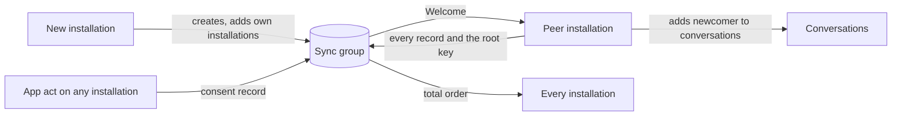

# Device sync

A user's installations exchange preferences over a group only they belong to: the sync group. What travels over it is a consent record (`CONS`) or the HMAC root key that push suppression derives from (PUSH-258). Both are the user's own state, so accepting an invitation to a sync group grants access to that state, and the rule for trusting one is a security boundary.

A new installation creates a sync group and adds every other installation of its inbox. The Welcome it sends is how those installations learn that it exists: each adds the new installation to the user's conversations and publishes every consent record and the HMAC root key it holds, so that the newcomer holds them; it generates a root key only when it holds none. Every later preference change is published to the sync group and merged on each installation under a total order, so the same updates applied in any order leave the same state.



## Scope

In scope: when a sync group is created and who is in it, the trust rule for a sync-group Welcome and for a sync message, what a peer does when it learns of a new installation, the preference update wire format, what is published and when, how an update is applied, what a restart preserves, and that a sync group is hidden from an app.

Out of scope: the consent record and its merge (`CONS`), the join itself (`JOIN`), the membership commit that adds an installation (GMOD-029), HMAC key derivation and its use by a push server (PUSH-258), the archive and its transport (`ARCH`), and the content type envelope (CTYPE-001).

| Related | Relation |
| --- | --- |
| `CONS` | Owns the consent record, its wire form, and the merge. This spec owns carrying it. |
| `JOIN` | Owns the join. SYNC-010 adds the check a sync-group Welcome gets under JOIN-060. |
| `GMOD` | GMOD-029 owns the commit that reconciles a group's installations with identity state. SYNC-014 owns when a peer runs it for a newcomer. |
| `PUSH` | PUSH-258 owns the HMAC root key's derivation into per-conversation keys; PUSH-219 owns push eligibility. This spec owns the root key's cycling and propagation. |
| `CTYPE` | Owns `EncodedContent` and `ContentTypeId`, which a sync message is wrapped in, and CTYPE-001, which selects a codec by them. |
| `META` | Owns `CONVERSATION_TYPE` and `CREATOR_INBOX_ID` in immutable metadata, and META-019, which rejects a Welcome that lacks them. |
| `PROC` | Owns how a stored envelope is processed and how a message reader applies its selected scope (PROC-046). |
| `EVENT` | EVENT-001 reports consent and HMAC root key changes; EVENT-003 excludes sync groups from app events. |

## Terms

| Term | Meaning |
| --- | --- |
| Sync group | A group whose immutable metadata `CONVERSATION_TYPE` is `CONVERSATION_TYPE_SYNC`. |
| Sync message | An application message in a sync group whose content is a `DeviceSyncContent` under the content type in section 3. |
| Preference update | One `PreferenceUpdate`: a consent record or an HMAC root key. |
| Admissible update | A preference update in a sync message that SYNC-030 admits and SYNC-023 does not ignore. |
| Owed key | A consent key, or the root key, marked under SYNC-027 and not yet cleared under SYNC-033. |
| HMAC root key | The 42-byte secret every installation of an inbox shares, from which PUSH-258 derives per-conversation keys. |
| Cycle time | The `cycled_at_ns` of an HMAC root key: the time SYNC-026 gave it, capped on receipt under SYNC-032. |
| Local join time | The stored time at which the client created a group or completed its join from a Welcome. |
| Own inbox | The inbox the acting client belongs to. |

## 1. The sync group

Each installation that holds no sync group creates one and adds every other installation its inbox's identity state associates. An installation therefore belongs to one sync group per installation registered after it, plus its own, and the newest one is the one every current installation is in. A client publishes to that one and reads all of them, so an installation that has not yet received the newest Welcome still hears from the ones it has.

A sync group is the user's own state, not a conversation. It is never listed or streamed to an app that did not ask for sync groups, and its messages produce no push notification: PUSH-219 makes a group message push-eligible only when `should_push` is true. Whether a consent record exists for a sync group has no effect; SYNC-005 hides it by conversation type.

| ID | Title | Requirement | Why |
| --- | --- | --- | --- |
| SYNC-001 | Create when none | When a client that may reach the backend runs and holds no sync group, it MUST create a group whose immutable metadata `CONVERSATION_TYPE` is `CONVERSATION_TYPE_SYNC` and add every installation that its inbox's identity state associates other than itself. | A peer installation learns of this one from the Welcome. Without it the peer never adds this installation to a conversation. |
| SYNC-002 | Publish to the newest | When the client publishes a preference update, it MUST publish it to the sync group with the greatest local join time, and on an equal time the greatest group id under byte order. | One destination avoids publishing every preference to every held sync group. SYNC-031 orders joins, and SYNC-034 repairs the selected group's installation set. |
| SYNC-031 | Join times only grow | When the client stores a sync group, by creating it or from a Welcome, it MUST set its local join time to the greater of its current time and the greatest local join time of a sync group it holds plus one nanosecond. | SYNC-002 publishes to the greatest join time. A join time from a clock that was later set back keeps an older group selected, and a newcomer that is not in it receives nothing. |
| SYNC-003 | Read every sync group | The client MUST apply admissible updates from every sync group it belongs to, not only the one SYNC-002 selects. | An installation that has not received the newest Welcome publishes to an older group, and a reader of the newest alone misses it. |
| SYNC-004 | No push for sync messages | When the client publishes a sync message, it MUST publish it with `should_push` false. | Every consent change would otherwise notify the user on every device. |
| SYNC-005 | Hidden from the app | The client MUST NOT return a sync group in a listing or stream of conversations, or its messages in a stream of messages across conversations, unless the app asked for sync groups. | |

## 2. Trust

A Welcome names the inbox that added the recipient (JOIN-025) and the membership it asserts (JOIN §8). JOIN §8 checks that every leaf node belongs to the inbox it claims; it does not ask which inbox that is. For every other conversation kind the joiner accepts strangers; a sync group is the one kind in which it may not. A sync group created by another inbox, or one with another inbox in it, is a group into which this client would publish its consent decisions and the key its push suppression depends on. JOIN-060 rejects a Welcome that fails the checks its kind demands; SYNC-010 states the checks for this kind.

The same rule applies to what is read. A sync message is applied only when its sender was an installation of the own inbox when the message was sent, whatever group it arrived in (SYNC-030).

| ID | Title | Requirement | Why |
| --- | --- | --- | --- |
| SYNC-010 | Only the own inbox is a member | When a Welcome carries a group whose `CONVERSATION_TYPE` is `CONVERSATION_TYPE_SYNC`, the client MUST record a terminal rejection for it unless the adder under JOIN-025 is the own inbox and every leaf node in the ratchet tree names the own inbox. When the client validates a commit to such a group, it MUST record a terminal rejection for the commit if `GROUP_MEMBERSHIP` after the commit names an inbox other than `CREATOR_INBOX_ID`. | Anyone can create a group and name it a sync group. Accepting one makes it the group this client publishes to under SYNC-002, and its members read every consent decision and the HMAC root key. An installation of the own inbox can still commit another inbox into a group it already holds, and that inbox stays after the installation is revoked. GMOD-012 binds every new leaf to an inbox in `GROUP_MEMBERSHIP`, so the one entry keeps every leaf in the creator's inbox. |
| SYNC-030 | Senders are judged when they sent | When the client applies a sync message, it MUST first load the own inbox's identity updates from the network, after the message was stored. It MUST apply the message's preference updates only when the sender is an installation of the own inbox in the own identity state after the last own identity update whose server time is at or before the message's envelope time. When the sender is not, the client MUST NOT apply the message ever when an earlier state held the sender, and MUST otherwise leave the message to be applied later. | An accepted update sets consent and replaces the HMAC root key. A message an installation sent before its revocation is then applied on every installation whose identity read is current, and one sent after it on none, whenever each one processes it. A registration that this client's identity read has not seen yet must not drop a newcomer's message for good. |

## 3. Preference updates

A sync message is an application message whose content is an `EncodedContent` with `ContentTypeId` authority `xmtp.org`, type `application/x-protobuf`, and major version 1, and whose `content` bytes are an encoded `DeviceSyncContent`. CTYPE-001 selects the codec by those three values.

```proto
// All potential device sync group messages
message DeviceSyncContent {
  reserved 1, 3;
  reserved "request", "reply";

  oneof content {
    DeviceSyncAcknowledge acknowledge = 2;
    PreferenceUpdates preference_updates = 4;
  }
}

// Acknowledges a request
message DeviceSyncAcknowledge {
  string request_id = 1;
}

// Preference updates
message PreferenceUpdates {
  repeated PreferenceUpdate updates = 1;
}

// Preference update
message PreferenceUpdate {
  oneof update {
    xmtp.device_sync.consent_backup.ConsentSave consent = 1;
    HmacKeyUpdate hmac = 2;
  }
}

// Hmac key update
message HmacKeyUpdate {
  bytes key = 1;
  int64 cycled_at_ns = 2;
}
```

Fields 1 and 3 of `DeviceSyncContent` carried a history transfer that older installations still send. `acknowledge` is its reply and carries nothing to apply. A message a client cannot use is ignored and does not stop the messages behind it. The sync group carries no archive; an archive travels by a channel the app chooses (`ARCH`).

Publishing is stored state, not an event. A change the client stores to a consent record or to the root key marks the key as owed in the same transaction, unless it came from the selected sync group (SYNC-027). The client publishes the current value of every owed key (SYNC-029) and clears the mark only after a sync message carrying it is published (SYNC-033). So a restart loses nothing, many changes to one key are sent once, no failure count drops a change, and sending a value again never changes it. A value received in the sync group SYNC-002 selects is not sent back, because every installation there received it from its sender.

Both update kinds merge without regard to order (CONS-053, SYNC-032), so applying a message twice, or after a greater one, changes nothing. The client's own messages are applied like a peer's once they are published.

| ID | Title | Requirement | Why |
| --- | --- | --- | --- |
| SYNC-020 | Wire format | When the client publishes a preference update, it MUST publish a sync message whose `DeviceSyncContent` carries `preference_updates` with each update as a `PreferenceUpdate` defined above, with a consent record encoded under CONS-050. | |
| SYNC-027 | Mark every change owed | When the client stores a change to a consent record or to its root key, it MUST mark the key as owed in the same transaction, with a mark it has not used before. The exception is a change from a sync message in the sync group SYNC-002 selects: such a change MUST leave the key's mark as it was. | A change held in memory is lost on restart. A value from the selected group reached every installation in it from its sender, so sending it back is an echo. A value from an older group may have reached no one in the selected group, for example when its sender stopped running. A received value never clears a mark, because the mark can stand for a newcomer that has not received the key (SYNC-035). |
| SYNC-029 | Publish owed keys | The client MUST publish the current value of every owed key as a preference update under SYNC-020. It MUST publish to the sync group SYNC-002 selects after it reads the values, in sync messages of at most 1,000 updates each. Each message's encoded updates MUST fit within a quarter of the deployment's envelope limit and within 262,144 bytes, unless the message carries a single update. | A message refused for being too large fails on every retry. A single update always goes out, or a record larger than the budget could never be sent. Reading the values first means a newcomer's Welcome that commits in between either marks them again or is already the selected group. |
| SYNC-033 | Clear a mark only after publication | Before the client queues a sync message under SYNC-029, it MUST wait until every sync message it queued earlier in that sync group is published or has failed for good, and after a failure for good it MUST queue the owed values again. It MUST clear a key's mark only after a sync message that carries the key's value is published, and only when the key still holds the mark it had when the client read that value. It MUST NOT stop publishing an owed key after any number of failures or across a restart. | A change dropped after failures stays on one installation. A mark cleared when a message is queued is lost when the message is refused. A queue of retries holds many copies of one change. |
| SYNC-032 | The greater root key wins | When the client receives an `HmacKeyUpdate` whose `key` is 42 bytes, it MUST cap its `cycled_at_ns` at one day after the envelope time of the sync message that carries it. It MUST then store the key and that time when it holds no root key, or when the time is greater than the stored cycle time, or when the times are equal and the received `key` is greater under byte order; otherwise it MUST leave the stored key unchanged. It MUST NOT store a key that is not 42 bytes. | Two installations that keep different root keys register different per-conversation keys, and a message one of them sends notifies the other. A tie left to arrival order leaves two devices with two keys. A key timed far ahead would beat every later cycle, including the one SYNC-026 makes on revocation. |
| SYNC-023 | Ignore what cannot be used | When a sync message's `DeviceSyncContent` has no `content` set, carries `acknowledge`, or contains a `PreferenceUpdate` with no `update` set, the client MUST ignore that content or that update without failing the message and MUST apply the other admissible updates in the same message. | An older installation's history transfer, or a newer installation's update kind, would otherwise stop every update behind it. |

## 4. A new installation

The Welcome to a sync group is the signal that a new installation exists. In the transaction that installs it, a peer gives the group a join time after every sync group it holds, so the group becomes the one SYNC-002 selects (SYNC-031). It also schedules the adds to the user's conversations (SYNC-014) and marks every consent record and its root key as owed (SYNC-035). A newcomer that a publish adds to an existing sync group sends no Welcome; a peer that applies the commit adding its leaf does both in the transaction that applies it. So the newcomer receives everything the peer holds, and a restart at any point loses none of it. The peer sends the root key it holds; it generates one only when it holds none. The root key is cycled when another installation of the inbox is revoked, so the revoked installation's copy stops matching (SYNC-026). The new key is timed after every key the revoked installation could have sent. SYNC-034 removes the revoked installation from the sync group before the new key is published.

Which conversations the newcomer is added to is a consent decision. A denied conversation is not shared, and a conversation with no activity for 90 days is left for its next reconciliation. A conversation's activity time is the `sent_at_ns` of its last stored message when it has one, and its local join time otherwise.

The newcomer merges what arrives under CONS-053 like any other update. A DM's record is its peer's inbox record, so it applies to every DM with that person that the newcomer holds or joins later.

Both acts survive a restart. The add is a commit the peer owes until it lands or the group is gone; an update the client received is applied whether or not the process that received it is the one that applies it. How a stored envelope is processed is owned by `PROC`; this spec owns only the effect on stored consent and the root key.

| ID | Title | Requirement | Why |
| --- | --- | --- | --- |
| SYNC-014 | Add the newcomer to conversations | When the client joins a sync group from a Welcome, or applies a commit that adds an installation key absent from that sync group's preceding leaf set, it MUST, for every group and DM whose conversation consent is allowed or unknown and whose activity time is greater than the current time minus 90 days, publish a commit that adds each installation that its inbox's identity state associates and the group's membership lacks, and MUST complete that commit after any restart until it lands or the group is no longer held. | A newcomer no peer adds reads nothing until each conversation's next reconciliation, which for a quiet one is never. A newcomer added to an existing sync group sends no peer a sync Welcome. |
| SYNC-035 | Replay after a newcomer joins | When the client joins a sync group from a Welcome, it MUST, in the transaction that completes the join, mark every consent record it stores and its root key as owed under SYNC-027. When it applies a commit that adds an installation key absent from that sync group's preceding leaf set, it MUST make the same marks in the transaction that applies the commit. When it holds no root key, it MUST first store one under SYNC-026. | Adding a leaf gives it future messages but no earlier preferences. Every peer can hold records the adding peer lacks, and a replay marked after the membership transaction can be lost on restart. Fresh marks keep an earlier in-flight publication from clearing the replay. |
| SYNC-026 | Cycle the root key | When the client learns that an installation of its own inbox other than itself was revoked, or needs a root key and holds none, it MUST store a new 42-byte root key drawn from a cryptographically secure random source, with a cycle time equal to the greatest of its current time and the stored cycle time plus one nanosecond. For a revocation, the cycle time MUST also be at least one day after the server time of the identity update that revoked the installation. | A revoked installation that keeps a valid key can still suppress the user's notifications. A cycle that does not come after the stored key loses to a key a compromised installation timed ahead. A key the revoked installation sent before its revocation is applied (SYNC-030) with a time below the revocation's server time plus one day (SYNC-032), so a cycle at or after that bound beats it even when the client applies that key after it cycles. |
| SYNC-034 | Reconcile before publishing | Before the client publishes a sync message to the group SYNC-002 selects, when that group contains a leaf other than its own that the newest locally stored own-inbox identity state does not associate, or lacks an installation that state associates, the client MUST publish a membership commit that raises the own inbox's entry to that state's sequence id, removes those revoked leaves, and adds the missing own installations under JOIN-093 and GMOD-055. It MUST list associated installations still without leaves in `failed_installations` and MUST NOT publish the sync message while a revoked leaf remains. When an associated installation still has no leaf, it MUST, unless a rate limit refused the add (RATE-041), publish the sync message to the leaves the group holds and, when the group's floor admits GMOD-055's retry, MUST store a retry of the add that survives a restart, runs whether or not any key is owed, and runs after each GMOD-055 retry interval while that group is still the one SYNC-002 selects and the installation is still associated and has no leaf. | A revoked leaf reads the new root key and consent decisions. A missing current installation receives neither; selecting the newest join does not repair that omission. One installation without a usable key package does not hold preferences back from the installations that can read them, and the stored retry adds it once it can be added, even when nothing new is published. |
| SYNC-016 | Updates survive a restart | After a restart, the stored consent and HMAC root key MUST reflect every admissible update the client received before the restart, merged under CONS-053 and SYNC-032, whether or not the process that received it applied it. | A restart mid-way otherwise leaves a device that never converges, and neither device can tell. |
| SYNC-017 | One failure does not block the rest | If applying an admissible update fails, then the client MUST still apply the other admissible updates it holds. | |

## Known limitations

SYNC-034 judges revocation by the publisher's local identity state. A publisher that has not yet loaded a revocation still publishes to a group that holds the revoked leaf, and the revoked installation reads that update. A revoked leaf stays in a sync group that no current installation publishes to; nothing new reaches it there. A sync group can keep a revoked leaf that no valid commit can remove, left by a commit made before GMOD-046, until the inbox publishes another identity update; until then, every current installation's sync publish to that group fails under SYNC-034.

A publication waits while the sync group cannot be reached, or while the own identity state cannot be read (SYNC-034). It is retried with backoff and never dropped. Until it succeeds, the other installations do not hold the change. A message the deployment refuses for good is retried for good, and the owed values behind it wait. After a network failure, the next attempt can send one message twice.

SYNC-030 judges a sender against the identity updates the backend returns. A read served by a replica that has not yet stored a revocation reports the revoked installation as current. A message that installation sends in that window is applied by a device that read the lagging replica and dropped by one that read later. The device that applied the value can pass it on to other installations (SYNC-027, SYNC-035), so they can adopt it too; a later decision by the user replaces it. A root key applied this way is replaced when that device loads the revocation and cycles under SYNC-026.

A new installation holds only its own decisions until a peer that has processed its Welcome, or the commit that added it, publishes under SYNC-035. A record held only by installations that never run again never arrives. A new installation that needs a root key before one arrives makes its own under SYNC-026; it is the newest, so it replaces the account's key on every installation.

A sync group is never removed. An inbox with many installations holds one sync group per installation, and each installation reads all of them.

Two root-key cycles on installations that have not seen each other's key are ordered by their clocks.

SYNC-026 cycles when the client stores a revocation. A restart between storing it and the cycle skips the cycle on that installation; every other installation cycles on its own.

A sync message whose sender no own identity state has held stays unapplied, and is read again on every pass.

A registration absent from the publisher's stored identity state is not added until the publisher learns it and next publishes. An associated installation that has no key package satisfying JOIN-093 receives nothing from the selected sync group until a retry adds it; the installations in that group still receive every publication. GMOD-055's retry interval and version condition still apply; a previously skipped key in a group below that floor is not retried, so it receives nothing there. An associated installation that never again offers a usable key package, such as one that stopped running without being revoked, is retried each interval until it is revoked. An idle, unselected sync group receives no periodic membership repair.
